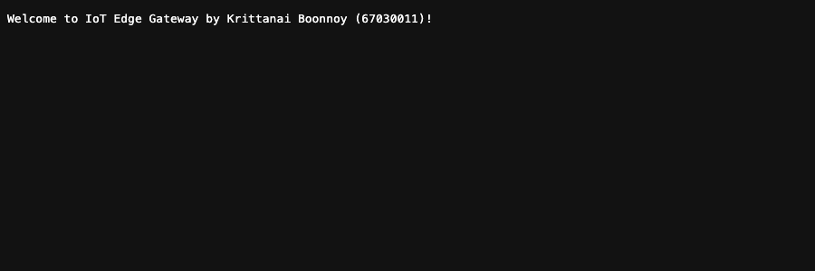
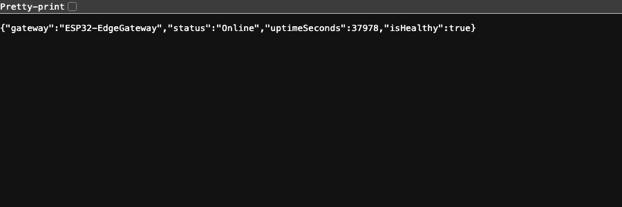
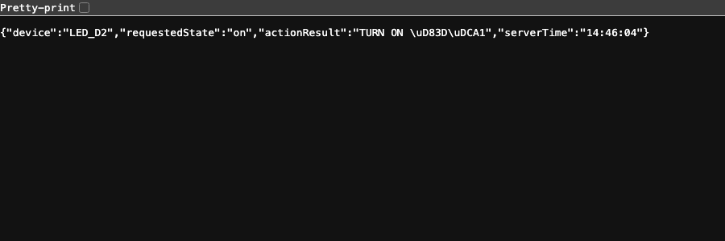
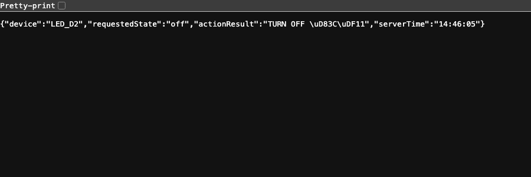
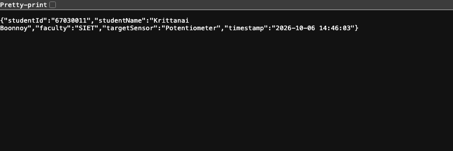

# ใบงานการทดลองที่ 8.1 (Labsheet 8.1)
## พื้นฐาน Kestrel Web Server และ Minimal API

> **คำชี้แจง** ใบงานนี้มุ่งเน้นให้นักศึกษาได้สัมผัสประสบการณ์การสร้าง High-Performance Web Server ด้วยตนเองผ่านกระบวนการ *"ได้ทดลอง ได้เห็นผลลัพธ์ทีละว้าว"* โดยจะค่อยๆ สร้างโค้ดทีละสเต็ปสั้นๆ ห้ามคัดลอกโค้ดก้อนใหญ่ เพื่อสร้างความเข้าใจที่แท้จริง

---
## วัตถุประสงค์การทดลอง (Objectives)
1. สามารถติดตั้งและตรวจสอบสภาพแวดล้อมการทำงานของ .NET 8 / 9 SDK ได้
2. สามารถสร้างและรัน Kestrel Web Server ด้วยคำสั่ง .NET CLI ได้อย่างถูกต้อง
3. เข้าใจโครงสร้างของไฟล์โปรเจกต์ `.csproj` และไฟล์โค้ดหลัก `Program.cs`
4. สามารถสร้าง Minimal API Endpoint ที่ส่งคืนข้อมูลแบบสตริงธรรมดาและออบเจกต์ JSON อัตโนมัติได้
5. สามารถเขียน Endpoint รับค่าพารามิเตอร์ผ่าน URL Path ได้ด้วยตนเอง

---
## เครื่องมือและสิ่งที่ต้องเตรียม (Prerequisites)
- คอมพิวเตอร์ระบบปฏิบัติการ Windows / macOS / Linux
- ติดตั้ง **.NET SDK 8.0** หรือใหม่กว่า
- โปรแกรม **Visual Studio Code (VS Code)**
- เว็บเบราว์เซอร์ (Google Chrome, Microsoft Edge)

---

### ใบงานย่อยที่ 8-1 การสร้างเว็บไซต์อย่างง่ายด้วย Kestrel  
#### กิจกรรมที่ 1 การตรวจสอบความพร้อมของระบบและสร้างโปรเจกต์ 

1. เปิดโปรแกรม **Terminal** หรือ **PowerShell** ใน VS Code แล้วพิมพ์คำสั่งตรวจสอบเวอร์ชัน
   ```bash
   dotnet --version
   ```
   > *ผลลัพธ์ควรแสดงเป็นตัวเลข เช่น `8.0.xxx`,   `9.0.xxx`  หรือ 10.0.xxx*

2. สร้างโฟลเดอร์สำหรับการทดลองใบงานย่อยที่ 8.1 และสร้างโปรเจกต์ Web ว่างเปล่า (Empty Web)
   ```bash
   # สร้างโฟลเดอร์และเข้าไปด้านใน
   mkdir Lab8-1 && cd Lab8-1

   # สร้างโปรเจกต์ Web ว่างเปล่า
   dotnet new web -o .
   ```

3. ทดลองสั่งรันเว็บเซิร์ฟเวอร์
   ```bash
   dotnet run
   ```
   สังเกตข้อความบน Terminal จะพบข้อความแจ้งว่าเซิร์ฟเวอร์เริ่มทำงานแล้ว
   ```text
   info: Microsoft.Hosting.Lifetime[14]
         Now listening on: http://localhost:5xxx
   ```
โดย 5xxx จะเป็นเลข 4 หลักที่ระบบสร้างมาให้

4. เปิดเบราว์เซอร์แล้วพิมพ์ URL: `http://localhost:5xxx`  
   หรือกด ctrl + click ที่บรรทัด `Now listening on: http://localhost:5xxx`
   **สิ่งที่เห็น** คำว่า **"Hello World!"** ปรากฏบนหน้าจอ

> **หมายเหตุ (macOS):** พอร์ต `5000` บน macOS ถูก **AirPlay Receiver** (โปรเซส `ControlCenter`) จองไว้ (`lsof -iTCP:5000` → `ControlCe ... TCP *:5000 (LISTEN)`) จึงตั้ง `applicationUrl` ใน `Properties/launchSettings.json` เป็น `http://localhost:5080` แทน ทุก URL ในรายงานนี้จึงใช้พอร์ต `5080`

> สังเกตว่าเราไม่ต้องติดตั้ง Apache, ไม่ต้องรัน Nginx, ไม่ต้องคอนฟิก PHP เลยแม้แต่น้อย โปรแกรม `.exe` ที่เราเขียนมี Kestrel Web Server ฝังตัวอยู่แล้วในกระบวนการ

---

#### [Checkpoint 1.1 ทดสอบความเข้าใจ]


1. ในหน้าจอ Terminal ขณะที่เซิร์ฟเวอร์กำลังรันอยู่ ให้กดปุ่ม `Ctrl + C` เพื่อหยุดโปรแกรม
2. กลับไปที่หน้าเบราว์เซอร์แล้วกดปุ่ม **Refresh (F5)** สังเกตว่าเกิดอะไรขึ้น และอธิบายสั้นๆ ว่าทำไมจึงเป็นเช่นนั้น
   - **คำตอบ:** เบราว์เซอร์แสดงหน้า Error **"This site can't be reached / ERR_CONNECTION_REFUSED"** (ทดสอบด้วย `curl` ได้ `curl: (7) Failed to connect to localhost port 5080 ... Couldn't connect to server`) เพราะ Kestrel ไม่ได้เป็น Service แยกที่รันค้างอยู่ในระบบแบบ Apache/IIS แต่ **ฝังตัวอยู่ในโปรเซสของโปรแกรมเราเอง** เมื่อกด `Ctrl + C` โปรเซสจบการทำงาน Socket ที่ Listen พอร์ต 5080 ก็ถูกปิดไปด้วย จึงไม่มีใครรับ TCP Connection อีกต่อไป (OS ตอบกลับด้วย TCP RST)

---

#### กิจกรรมที่ 2 โครงสร้างและเขียนโค้ด

1. เปิดไฟล์ `Program.cs` ขึ้นมาดู จะพบว่ามีโค้ดเพียงไม่กี่บรรทัด
   ```csharp
   var builder = WebApplication.CreateBuilder(args);
   var app = builder.Build();

   app.MapGet("/", () => "Hello World!");

   app.Run();
   ```

2. ทดลองเปลี่ยนข้อความทักทายเป็นชื่อของนักศึกษาเอง เช่น
   ```csharp
   app.MapGet("/", () => "Welcome to IoT Edge Gateway by [ใส่ชื่อ-นามสกุลนักศึกษา]!");
   ```

3. บันทึกไฟล์ สั่ง `dotnet run` อีกครั้ง แล้วกด Refresh บนเบราว์เซอร์เพื่อดูผลลัพธ์



---

#### กิจกรรมที่ 3 การแปลง C# Object เป็น JSON โดยอัตโนมัติ 

ในระบบ IoT การสื่อสารส่วนใหญ่ใช้รูปแบบข้อมูล **JSON (JavaScript Object Notation)** มาดูกันว่า .NET จัดการเรื่องนี้ให้เราง่ายแค่ไหน

1. เปิดไฟล์ `Program.cs` แล้วเพิ่มโค้ด Endpoint ใหม่เข้าไป **ก่อนบรรทัด `app.Run();`**
   ```csharp
   app.MapGet("/api/status", () => new {
       gateway = "ESP32-EdgeGateway",
       status = "Online",
       uptimeSeconds = Environment.TickCount64 / 1000,
       isHealthy = true
   });
   ```

2. สั่ง `dotnet run` จากนั้นเปิดเบราว์เซอร์ไปที่  
     `http://localhost:5000/api/status`

3. **สิ่งที่เห็น** หน้าจอเบราว์เซอร์จะแสดงผลเป็น JSON โครงสร้างสมบูรณ์
   ```json
   {
     "gateway": "ESP32-EdgeGateway",
     "status": "Online",
     "uptimeSeconds": 25,
     "isHealthy": true
   }
   ```



ผล `curl -i` ยืนยันว่า Kestrel แปะ Header ให้เองจริง:
```text
HTTP/1.1 200 OK
Content-Type: application/json; charset=utf-8
{"gateway":"ESP32-EdgeGateway","status":"Online","uptimeSeconds":36669,"isHealthy":true}
```

> เราไม่ได้สั่ง `json_encode()` หรือแปลงสตริงเลย เพียงแค่เราส่ง C# Anonymous Object ออกมา Kestrel จะทำการ Serialize เป็น JSON และแปะ Header `Content-Type: application/json` ให้อัตโนมัติ!

---

#### กิจกรรมที่ 4 การรับค่าผ่าน URL Path (Route Parameters)

เพิ่มฟังก์ชันการรับคำสั่งควบคุม เช่น สั่งเปิด-ปิดหลอดไฟ LED หรือรีเลย์ผ่าน URL

1. เพิ่ม Endpoint ต่อไปนี้ลงใน `Program.cs`
   ```csharp
   app.MapGet("/api/led/{state}", (string state) => {
       string action = state.ToLower() == "on" ? "TURN ON 💡" : "TURN OFF 🌑";
       return Results.Ok(new { 
           device = "LED_D2", 
           requestedState = state, 
           actionResult = action,
           serverTime = DateTime.Now.ToString("HH:mm:ss")
       });
   });
   ```

2. ทดสอบเปิด URL บนเบราว์เซอร์
   - ทดสอบพิมพ์ `http://localhost:5000/api/led/on`
   - ทดสอบพิมพ์ `http://localhost:5000/api/led/off`
   - สังเกตผลลัพธ์ JSON ที่ได้รับกลับมา


เพิ่มบรรทัด 
```csharp
	Console.WriteLine($"[{DateTime.Now:HH:mm:ss}] LED Control: {state}");
```
ถัดจากบรรทัด
```csharp
	    string action = state.ToLower() == "on" ? "TURN ON 💡" : "TURN OFF 🌑";   
```

เพื่อแสดงสถานะของ LED ที่ terminal

จากนั้นทดลองเปลี่ยนข้อความที่ URL bar แล้วสังเกตุและบันทึกผลที่ terminal
**ผลลัพธ์ที่คาดหวังบนเทอร์มินอล**
```
[xx:xx:xx] LED Control: on
[xx:xx:xx] LED Control: off
```

**ผลที่บันทึกได้จริง** (ทดลองพิมพ์ `on`, `off` และ `blink`):

| URL | `actionResult` ที่ได้ | Log บน Terminal |
| :--- | :--- | :--- |
| `/api/led/on` | `TURN ON 💡` | `[14:00:15] LED Control: on` |
| `/api/led/off` | `TURN OFF 🌑` | `[14:00:16] LED Control: off` |
| `/api/led/blink` | `TURN OFF 🌑` | `[13:59:50] LED Control: blink` |




**ข้อสังเกต:** เงื่อนไข `state.ToLower() == "on" ? ... : ...` ทำให้ค่าอะไรก็ตามที่ไม่ใช่ `on` (เช่น `blink`, `xyz`) ถูกตีความเป็น **TURN OFF** ทั้งหมดและยังตอบ `200 OK` ถ้าเป็นอุปกรณ์จริงควรตรวจค่าแล้วตอบ `400 Bad Request` เมื่อได้คำสั่งที่ไม่รู้จัก และใน JSON อีโมจิถูก Escape เป็น `\uD83D\uDCA1` (UTF-16 Surrogate Pair) ซึ่งเป็นพฤติกรรมปกติของ `System.Text.Json`


---

## ภารกิจท้าทาย (Micro-Challenge)

ให้นักศึกษาเขียน Endpoint ของตัวเองเพิ่มลงใน `Program.cs` ตามเงื่อนไขดังนี้

1. ตั้งชื่อ Path ว่า `/api/student`
2. เมื่อเปิดเข้าไปดู จะต้องคืนค่า JSON ที่มีข้อมูลดังต่อไปนี้
   - `studentId` = รหัสนักศึกษาของตนเอง (ชนิดสตริง)
   - `studentName`= ชื่อ-นามสกุลภาษาอังกฤษของตนเอง
   - `faculty`= คณะและสาขาวิชาที่กำลังศึกษา
   - `targetSensor`= ชื่อเซนเซอร์ที่ตนเองสนใจนำมาต่อกับ ESP32 ในวิชานี้ (เช่น "DHT22", "Potentiometer", "MQ-2")
   - `timestamp`= เวลาปัจจุบันของเซิร์ฟเวอร์ (`DateTime.Now.ToString(...)`)

 **หลักฐานการส่งงาน** บันทึกภาพหน้าจอเบราว์เซอร์ที่เปิดแสดงผล JSON จาก `/api/student` พร้อมโค้ดใน VS Code ลงในรายงานผลการทดลอง

**โค้ดที่เพิ่ม** ([HW-67030011/Lab8-1/Program.cs](HW-67030011/Lab8-1/Program.cs)):
```csharp
app.MapGet("/api/student", () => new {
    studentId = "67030011",
    studentName = "Krittanai Boonnoy",
    faculty = "SIET",
    targetSensor = "Potentiometer",
    // ใช้ InvariantCulture เพราะเครื่องที่ตั้ง Locale ไทยจะได้ปี พ.ศ. (2569) แทน ค.ศ.
    timestamp = DateTime.Now.ToString("yyyy-MM-dd HH:mm:ss", System.Globalization.CultureInfo.InvariantCulture)
});
```

**ผลลัพธ์:**



**ข้อสังเกต:** ครั้งแรกที่เขียน `DateTime.Now.ToString("yyyy-MM-dd HH:mm:ss")` เฉยๆ ได้ผลเป็น `"2569-10-06 13:59:50"` เพราะ macOS ตั้ง Region เป็นไทย (`en_TH`) .NET จึงใช้ **ปฏิทินพุทธศักราช** ตาม CurrentCulture ถ้าส่งค่านี้ไปให้ระบบอื่น parse เป็น ค.ศ. จะได้ปีเพี้ยนไป 543 ปี จึงต้องระบุ `CultureInfo.InvariantCulture` ทุกครั้งที่สร้าง Timestamp สำหรับ API

---

## คำถามท้ายการทดลอง (Review Questions)
1. **ในสถาปัตยกรรมของ Kestrel ตัวแปร `builder` ทำหน้าที่อะไร และตัวแปร `app` ทำหน้าที่อะไร**
   * **คำตอบ:** `builder` (`WebApplicationBuilder`) เป็นช่วง **"ประกอบเครื่อง" ก่อนสตาร์ต** ใช้ลงทะเบียน Service เข้า Dependency Injection Container (`builder.Services.AddSingleton<...>()`, `AddHostedService<...>()`), อ่าน Configuration (`appsettings.json`, Environment, Command line) และตั้งค่า Logging / Kestrel เมื่อเรียก `builder.Build()` จะได้ `app` (`WebApplication`) ซึ่งเป็น **ตัวเซิร์ฟเวอร์ที่ประกอบเสร็จแล้ว** ใช้กำหนด Middleware Pipeline (`UseStaticFiles()`, `UseFileServer()`) และผูก Route กับ Handler (`MapGet(...)`) ก่อนสั่ง `app.Run()` ให้ Kestrel เริ่ม Listen พอร์ต หลัง `Build()` แล้วจะเพิ่ม Service ไม่ได้อีก

2. **เปรียบเทียบความสะดวกระหว่างการสร้าง Web Server บน .NET Minimal API กับการรันผ่าน LAMP Stack (Apache + PHP) ว่ามีข้อดีข้อเสียต่างกันอย่างไรในมุมมองของงาน IoT Gateway**
   * **คำตอบ:**

     | ประเด็น | .NET Minimal API (Kestrel) | LAMP (Apache + PHP) |
     | :--- | :--- | :--- |
     | การติดตั้ง | โปรแกรมเดียวจบ ไม่ต้องติดตั้ง Web Server แยก (`dotnet run` / Publish เป็นไฟล์เดียว) | ต้องติดตั้งและคอนฟิก Apache, PHP, MySQL แยกกัน |
     | งานเบื้องหลังต่อเนื่อง | มี `BackgroundService` อยู่ในโปรเซสเดียวกับเว็บ อ่าน Serial Port ค้างไว้ได้ตลอด และแชร์ข้อมูลผ่านหน่วยความจำได้เลย | PHP ทำงานแบบ Request-Response จบแล้วตาย เปิด Serial Port ค้างไว้ไม่ได้ ต้องมี Daemon แยก + ฐานข้อมูล/ไฟล์เป็นตัวกลาง |
     | ประสิทธิภาพ | Async I/O คอมไพล์เป็น Native/JIT รองรับ Polling ถี่ๆ (เช่น ทุก 150ms) ได้สบาย | สร้าง Process/Thread ต่อ Request ใช้ RAM มากกว่าบนอุปกรณ์ Edge |
     | ชนิดข้อมูล | Type-safe คืน Object แล้วได้ JSON อัตโนมัติ | ต้อง `json_encode()` และ `header()` เอง |
     | ข้อเสีย | ต้องมี .NET Runtime/SDK, ไฟล์ Publish ใหญ่กว่า, Hosting ราคาถูกส่วนใหญ่ไม่รองรับ | — (ข้อดีคือ Shared Hosting หาง่าย, ชุมชนใหญ่, แก้ไฟล์แล้วเห็นผลทันทีไม่ต้อง Build) |

     สำหรับ IoT Gateway ที่ต้องคุยกับฮาร์ดแวร์ตลอดเวลา Kestrel จึงเหมาะกว่า เพราะรวม "ตัวอ่านเซนเซอร์" กับ "เว็บเซิร์ฟเวอร์" ไว้ในโปรเซสเดียว

3. **นักศึกษาคิดว่าการเพิ่ม `/api/` เข้าไปใน route นั้นมีประโยชน์อย่างไรบ้าง ถ้าไม่ใส่จะเกิดปัญหาอะไรบ้าง**
   * **คำตอบ:** `/api/` เป็น **Namespace แยกระหว่าง "ข้อมูลสำหรับโปรแกรม" (JSON) กับ "หน้าเว็บสำหรับคน" (HTML/CSS/JS)** ทำให้
     * ไม่ชนกับไฟล์ Static ใน `wwwroot` เช่น ถ้ามี Route `/status` และไฟล์ `wwwroot/status` จะสับสนว่าควรตอบอะไร (ในใบงาน 8.4 ทดลองแล้วว่าถ้ามี `MapGet("/")` อยู่ Endpoint จะชนะ `index.html` ทันที)
     * ตั้งกฎรวมได้ทีเดียวทั้งกลุ่ม เช่น Authentication, CORS, Rate Limit, Logging หรือ Reverse Proxy (`location /api/ { ... }`) และทำ Versioning ต่อได้ (`/api/v1/...`)
     * คนอ่าน URL รู้ทันทีว่าเป็น REST API ที่คืน JSON
   * ถ้าไม่ใส่ Route ของ API จะปนกับหน้าเว็บ ชื่อชนกันง่ายเมื่อระบบโตขึ้น ตั้ง Middleware หรือ Proxy แยกเฉพาะ API ได้ยาก และ Client (ESP32/มือถือ) ที่ Hard-code URL ไว้จะพังเมื่อต้องย้ายโครงสร้างหน้าเว็บภายหลัง
