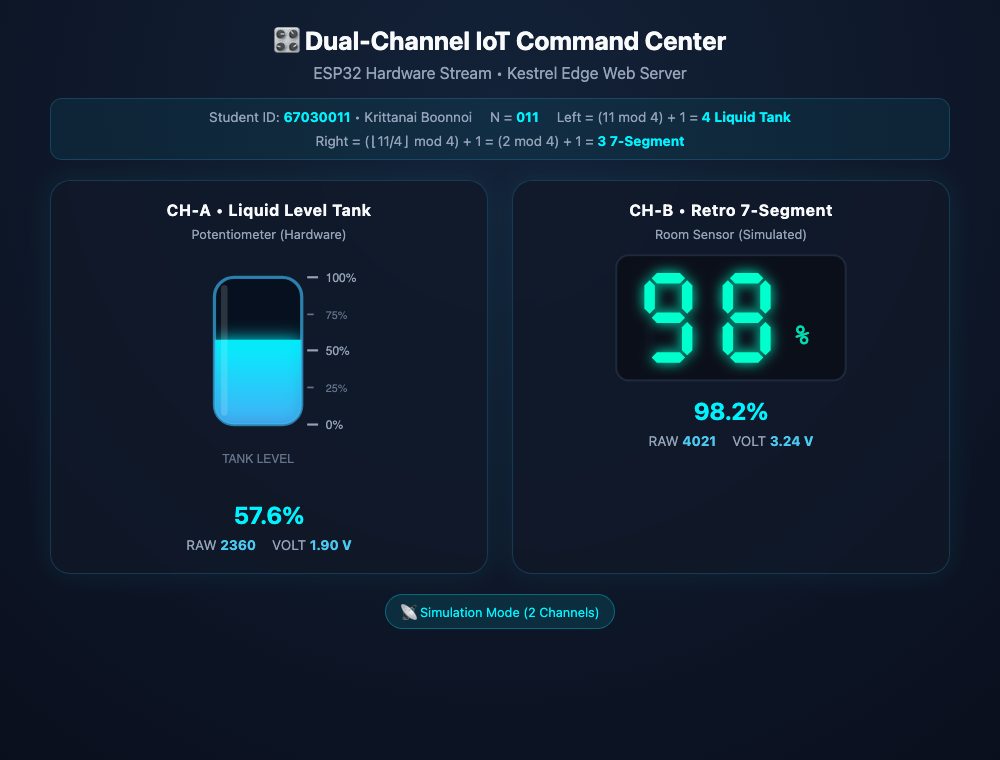
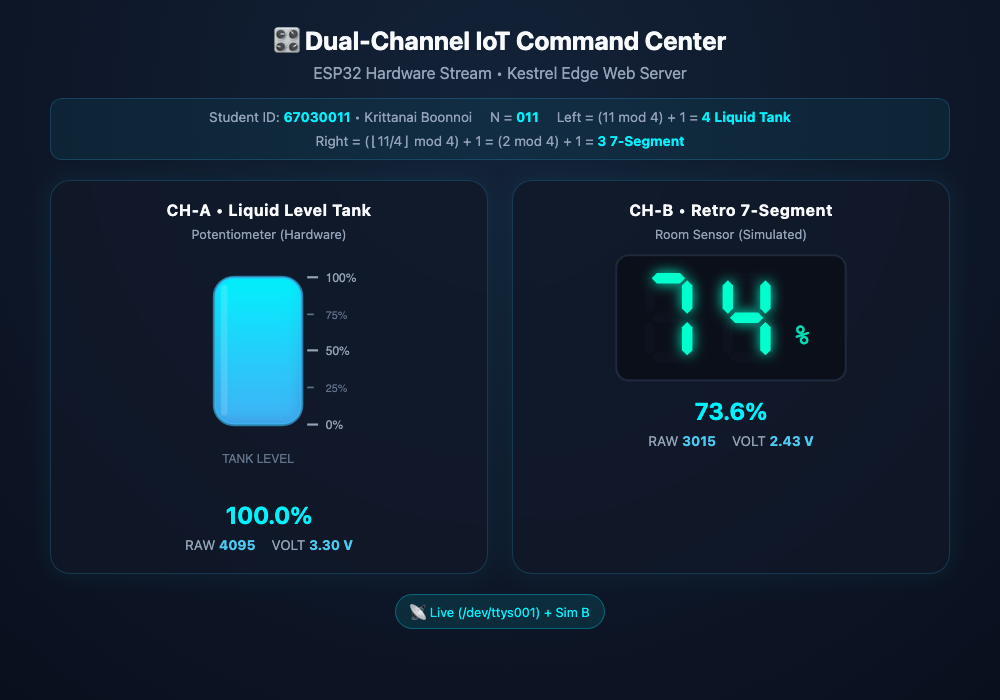
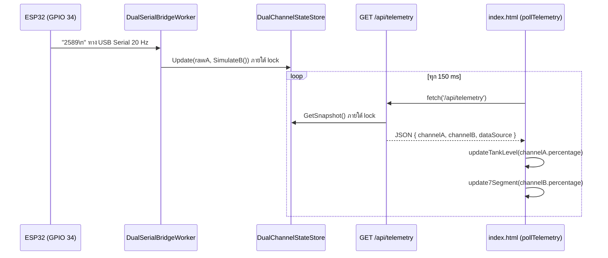

# ใบงานปฏิบัติการที่ 08-5
### ศูนย์ควบคุมเซนเซอร์คู่ IoT แบบเรียลไทม์ (Dual-Channel IoT Command Center)

---

##  วัตถุประสงค์การเรียนรู้ (Learning Objectives)
1. **สถาปัตยกรรมโทรมาตรหลายช่องสัญญาณ (Multi-Channel Telemetry Architecture)** สามารถออกแบบและจัดการคลังข้อมูล Thread-Safe ใน C# Kestrel เพื่อรองรับข้อมูลเซนเซอร์หลายตัวพร้อมกัน
2. **การจัดวางแดชบอร์ดระดับมืออาชีพ (Responsive Dual-Pane Grid)** สามารถจัดวางหน้าจอแสดงผลคู่ (Side-by-Side Dashboard) ด้วย CSS Grid และ Flexbox ที่รองรับทั้งหน้าจอเดสก์ท็อปและสมาร์ตโฟน
3. **การประยุกต์ใช้วิดเจ็ตตามโจทย์สุ่ม (Parametric Widget Customization)** สามารถนำชุดกราฟิก SVG และตรรกะ JavaScript ที่เรียนรู้จากใบงาน 8-4 มาผสมผสาน (Mix & Match) ตามเงื่อนไขเฉพาะบุคคลของรหัสนักศึกษาได้อย่างถูกต้อง

---

##  กติกากำหนดหน้าปัดเฉพาะบุคคล (Student-ID Gauge Assignment)

เพื่อส่งเสริมความคิดสร้างสรรค์และป้องกันการคัดลอกผลงาน นักศึกษาแต่ละคนจะต้องสร้างหน้าปัดคู่ **(เกจ์ซ้าย และ เกจ์ขวา)** ตามผลลัพธ์ที่คำนวณได้จาก **เลขรหัสนักศึกษา 3 ตัวท้าย ($N$)** ดังนี้

### สูตรการคำนวณหมายเลขเกจ์ (1 - 4)

ให้นำเลขรหัส 3 ตัวท้ายของตนเอง (สมมติ $N = 237$) มาคำนวณตามสูตร

| ตำแหน่งเกจ์         | สูตรคณิตศาสตร์                                           | ตัวอย่างคิดในใจ ($N = 237$)                                               | หมายเลขเกจ์ |
| :------------------ | :------------------------------------------------------- | :------------------------------------------------------------------------ | :---------: |
| **เกจ์ซ้าย (Left)** | **$\text{Left} = (N \pmod 4) + 1$**                      | $237 \pmod 4 = 1 \rightarrow 1 + 1$                                       |    **2**    |
| **เกจ์ขวา (Right)** | **$\text{Right} = (\lfloor N / 4 \rfloor \pmod 4) + 1$** | $\lfloor 237/4 \rfloor = 59 \rightarrow 59 \pmod 4 = 3 \rightarrow 3 + 1$ |    **4**    |

>  **กฎป้องกันเกจ์ซ้ำ (Anti-Collision Rule)**  
> หากคำนวณแล้วได้ `Left` และ `Right` เป็นเลขเดียวกัน (เช่น ได้ 1 ทั้งคู่) **ให้บวกเกจ์ขวาเพิ่ม 1** (หากได้ 4 ให้วนกลับมาเป็น 1) เพื่อให้ได้เกจ์ 2 ชนิดที่แตกต่างกันเสมอ

---

### ตารางเทียบหมายเลขเกจ์ (1 - 4)

| หมายเลข | ชนิดของเกจ์ (Widget Type) | ลักษณะการแสดงผล                                   |
| :-----: | :------------------------ | :------------------------------------------------ |
|  **1**  | **Analog Speedometer**    | หน้าปัดเข็มไมล์กวาดมุมองศา (-90° ถึง +90°)        |
|  **2**  | **Audio VU Meter**        | แถบหลอดไฟ LED นีออน 10 ดวง (เขียว/เหลือง/แดง)     |
|  **3**  | **Retro 7-Segment**       | หน้าจอดิจิทัลเรโทร 7 ส่วน 2 หลัก (00 - 99%)       |
|  **4**  | **Liquid Level Tank**     | ถังของเหลวอุตสาหกรรมขอบมน พร้อมขีดบอกระดับ 0-100% |

*ตัวอย่าง: รหัส 237 จะได้เกจ์ **(2, 4)** คือ **เกจ์ซ้ายเป็น VU Meter** และ **เกจ์ขวาเป็น ถังของเหลว (Liquid Tank)***

### ✅ การคำนวณของนักศึกษา (รหัส 67030011)

| ตำแหน่งเกจ์ | วิธีคำนวณ ($N = 011 = 11$) | หมายเลขเกจ์ | ชนิด |
| :--- | :--- | :---: | :--- |
| **เกจ์ซ้าย (Channel A)** | $11 \bmod 4 = 3 \rightarrow 3 + 1$ | **4** | **Liquid Level Tank** |
| **เกจ์ขวา (Channel B)** | $\lfloor 11/4 \rfloor = 2 \rightarrow 2 \bmod 4 = 2 \rightarrow 2 + 1$ | **3** | **Retro 7-Segment** |

ได้ Left = 4 และ Right = 3 ไม่ซ้ำกัน **จึงไม่ต้องใช้กฎ Anti-Collision**

---

## แหล่งข้อมูลเซนเซอร์ 2 ช่องสัญญาณ (Dual-Channel Stream)

1. **ช่องสัญญาณ A (Channel A - เกจ์ซ้าย)**
   * อ่านค่าจาก **Potentiometer ฮาร์ดแวร์จริงบนบอร์ด ESP32** ผ่านสาย USB Serial Port
2. **ช่องสัญญาณ B (Channel B - เกจ์ขวา)**
   * **ทางเลือกที่ 1 (แนะนำสำหรับทุกคน):** ให้ฝั่ง C# Background Worker สร้างสัญญาณจำลอง (Mathematical Simulation เช่น Sine Wave หรือ Smooth Random Walk) อัตโนมัติ
   * **ทางเลือกที่ 2 (คะแนนพิเศษ Bonus):** ต่อเซนเซอร์ตัวที่ 2 จริง (เช่น LDR หรือ Potentiometer อีกตัว) เข้าที่ขา ADC อื่นของ ESP32 (เช่น GPIO 35) แล้วเขียนโปรแกรมบน ESP32 ให้ส่งค่ามาเป็นคู่คั่นด้วยจุลภาค เช่น `printf("%d,%d\n", val1, val2);`


---

##  โครงสร้างข้อมูล JSON API (`/api/telemetry`)

ฝั่ง Kestrel Server จะส่งข้อมูลแบบ 2 ช่องสัญญาณในรูปแบบ JSON

```json
{
  "channelA": {
    "name": "Potentiometer (Hardware)",
    "rawValue": 2840,
    "voltage": 2.29,
    "percentage": 69.4
  },
  "channelB": {
    "name": "LDR / Room Sensor (Simulated)",
    "rawValue": 1720,
    "voltage": 1.39,
    "percentage": 42.0
  },
  "dataSource": "Live ESP32 (COM24) + Sim B",
  "lastUpdated": "2026-09-06T21:00:00.000Z"
}
```

---

## ขั้นตอนการลงมือปฏิบัติ (Step-by-Step Implementation)

### ขั้นตอนที่ 1 สร้างโฟลเดอร์โปรเจกต์ใหม่แยกเดี่ยว

เปิด Terminal และสร้างโปรเจกต์สำหรับ Lab 8-5

```bash
cd d:\GitHubRepos\__ENGEDU\__Iot_App_2569\Kestrel_Project\Lab8-5
dotnet new web -n Kestrel_Dual_Dashboard
cd Kestrel_Dual_Dashboard
dotnet add package System.IO.Ports --version 8.0.0
```

---

### ขั้นตอนที่ 2 พัฒนา C# Server รองรับ Dual-Channel (`Program.cs`)

เขียนโค้ด `Program.cs` เพื่อจัดการคลังข้อมูล 2 ช่องสัญญาณและเชื่อมต่อพอร์ต Serial

```csharp
using System.IO.Ports;
using Microsoft.AspNetCore.Builder;
using Microsoft.Extensions.DependencyInjection;
using Microsoft.Extensions.Hosting;
using Microsoft.Extensions.Logging;

var builder = WebApplication.CreateBuilder(args);

builder.Services.AddSingleton<DualChannelStateStore>();
builder.Services.AddHostedService<DualSerialBridgeWorker>();

var app = builder.Build();

app.UseDefaultFiles();
app.UseStaticFiles();

// Endpoint สถานะระบบ
app.MapGet("/api/status", () => Results.Ok(new
{
    gateway = "Kestrel Dual-Channel IoT Gateway",
    uptimeSeconds = Environment.TickCount64 / 1000,
    serverTime = DateTime.UtcNow.ToString("o")
}));

// Endpoint ส่งข้อมูล Telemetry 2 ช่อง
app.MapGet("/api/telemetry", (DualChannelStateStore state) => Results.Ok(state.GetSnapshot()));

app.Run();

// คลังข้อมูลส่วนกลาง 2 ช่องสัญญาณ (Thread-Safe)
public class DualChannelStateStore
{
    private readonly object _lock = new();
    private int _rawA = 0;
    private int _rawB = 0;
    private string _source = "Initializing";
    private DateTime _lastUpdated = DateTime.UtcNow;

    public void Update(int rawA, int rawB, string source)
    {
        lock (_lock)
        {
            _rawA = Math.Clamp(rawA, 0, 4095);
            _rawB = Math.Clamp(rawB, 0, 4095);
            _source = source;
            _lastUpdated = DateTime.UtcNow;
        }
    }

    public object GetSnapshot()
    {
        lock (_lock)
        {
            return new
            {
                channelA = new
                {
                    name = "Sensor A (Hardware)",
                    rawValue = _rawA,
                    voltage = Math.Round((_rawA / 4095.0) * 3.3, 2),
                    percentage = Math.Round((_rawA / 4095.0) * 100.0, 1)
                },
                channelB = new
                {
                    name = "Sensor B (Simulated / LDR)",
                    rawValue = _rawB,
                    voltage = Math.Round((_rawB / 4095.0) * 3.3, 2),
                    percentage = Math.Round((_rawB / 4095.0) * 100.0, 1)
                },
                dataSource = _source,
                lastUpdated = _lastUpdated.ToString("o")
            };
        }
    }
}

// Background Worker ดักฟัง Serial และสร้างสัญญาณจำลอง
public class DualSerialBridgeWorker : BackgroundService
{
    private readonly DualChannelStateStore _stateStore;
    private readonly ILogger<DualSerialBridgeWorker> _logger;

    public DualSerialBridgeWorker(DualChannelStateStore stateStore, ILogger<DualSerialBridgeWorker> logger)
    {
        _stateStore = stateStore;
        _logger = logger;
    }

    protected override async Task ExecuteAsync(CancellationToken stoppingToken)
    {
        await Task.Yield();
        while (!stoppingToken.IsCancellationRequested)
        {
            string[] availablePorts = SerialPort.GetPortNames();
            if (availablePorts.Length > 0)
            {
                string targetPort = availablePorts.FirstOrDefault(p => !p.Equals("COM1", StringComparison.OrdinalIgnoreCase)) ?? availablePorts[0];
                try
                {
                    using var serial = new SerialPort(targetPort, 115200) { ReadTimeout = 2000, DtrEnable = true, RtsEnable = true };
                    serial.Open();
                    serial.DiscardInBuffer();
                    _logger.LogInformation("✅ เชื่อมต่อฮาร์ดแวร์พอร์ต {Port} สำเร็จ", targetPort);

                    while (!stoppingToken.IsCancellationRequested && serial.IsOpen)
                    {
                        if (serial.BytesToRead > 0)
                        {
                            string line = serial.ReadLine().Trim();
                            if (line.Contains(','))
                            {
                                var parts = line.Split(',');
                                if (parts.Length >= 2 && int.TryParse(parts[0], out int vA) && int.TryParse(parts[1], out int vB))
                                    _stateStore.Update(vA, vB, $"Live ({targetPort})");
                            }
                            else if (int.TryParse(line, out int vA))
                            {
                                double t = Environment.TickCount64 / 1000.0;
                                int simB = (int)((Math.Sin(t * 1.2) + 1.0) / 2.0 * 4095);
                                _stateStore.Update(vA, simB, $"Live ({targetPort}) + Sim B");
                            }
                        }
                        await Task.Delay(50, stoppingToken);
                    }
                }
                catch { }
            }

            // Fallback เมื่อไม่ได้เสียบสาย USB
            double time = Environment.TickCount64 / 1000.0;
            int sA = (int)((Math.Sin(time * 0.8) + 1.0) / 2.0 * 4095);
            int sB = (int)((Math.Cos(time * 1.4) + 1.0) / 2.0 * 4095);
            _stateStore.Update(sA, sB, "Simulation Mode (2 Channels)");
            await Task.Delay(100, stoppingToken);
        }
    }
}
```

---

### ขั้นตอนที่ 3 ออกแบบหน้าจอแดชบอร์ดคู่ (`wwwroot/index.html`)

สร้างโฟลเดอร์ `wwwroot` และไฟล์ `index.html` โดยใช้ CSS Grid เพื่อแบ่งหน้าจอเป็นฝั่งซ้ายและขวา

```html
<!DOCTYPE html>
<html lang="th">
<head>
    <meta charset="UTF-8">
    <meta name="viewport" content="width=device-width, initial-scale=1.0">
    <title>Dual-Channel IoT Dashboard</title>
    <style>
        :root {
            --bg: #0a0f1d;
            --card: rgba(16, 24, 40, 0.75);
            --border: rgba(56, 189, 248, 0.2);
            --cyan: #00f2fe;
            --green: #00ffcc;
        }
        body {
            background: radial-gradient(circle at 50% 15%, #132238 0%, var(--bg) 100%);
            color: #f8fafc;
            font-family: 'Segoe UI', system-ui, sans-serif;
            display: flex;
            flex-direction: column;
            align-items: center;
            padding: 24px 16px;
        }
        /* CSS Grid วาง 2 คอลัมน์ รองรับ Responsive บนมือถือ */
        .dashboard-grid {
            display: grid;
            grid-template-columns: repeat(auto-fit, minmax(320px, 1fr));
            gap: 24px;
            width: 100%;
            max-width: 900px;
        }
        .widget-card {
            background: var(--card);
            border: 1px solid var(--border);
            border-radius: 20px;
            padding: 20px;
            backdrop-filter: blur(10px);
            display: flex;
            flex-direction: column;
            align-items: center;
        }
        .needle { transition: transform 0.12s cubic-bezier(0.1, 0.8, 0.3, 1); transform-origin: 100px 100px; }
        .led { transition: opacity 0.1s ease, filter 0.1s ease; }
        .seg { fill: #1e293b; opacity: 0.15; transition: opacity 0.08s ease; }
        .seg.active { fill: var(--green); opacity: 1; filter: drop-shadow(0 0 6px var(--green)); }
        #water-fill { transition: y 0.15s ease-out, height 0.15s ease-out; }
    </style>
</head>
<body>
    <h1>🎛️ Dual-Channel IoT Command Center</h1>
    <p style="color: #94a3b8; margin-bottom: 20px;">ESP32 Hardware Stream &bull; Kestrel Edge Web Server</p>

    <div class="dashboard-grid">
        <!-- การ์ดฝั่งซ้าย (เกจ์ที่คำนวณได้จากรหัสนักศึกษา) -->
        <div class="widget-card" id="card-left">
            <h3 id="title-left">CH-A: Left Gauge</h3>
            <div id="container-left">
                <!-- วางโค้ด SVG เกจ์ตัวแรกที่นี่ -->
            </div>
            <p id="val-left" style="font-size: 1.5rem; font-weight: bold; color: var(--cyan);">0.0%</p>
        </div>

        <!-- การ์ดฝั่งขวา (เกจ์ที่คำนวณได้จากรหัสนักศึกษา) -->
        <div class="widget-card" id="card-right">
            <h3 id="title-right">CH-B: Right Gauge</h3>
            <div id="container-right">
                <!-- วางโค้ด SVG เกจ์ตัวที่สองที่นี่ -->
            </div>
            <p id="val-right" style="font-size: 1.5rem; font-weight: bold; color: var(--cyan);">0.0%</p>
        </div>
    </div>

    <script>
        async function pollTelemetry() {
            try {
                const res = await fetch('/api/telemetry');
                if (!res.ok) return;
                const data = await res.json();

                // 1. อัปเดตเกจ์ฝั่งซ้าย ด้วย data.channelA.percentage
                updateLeftWidget(data.channelA.percentage);

                // 2. อัปเดตเกจ์ฝั่งขวา ด้วย data.channelB.percentage
                updateRightWidget(data.channelB.percentage);

            } catch (err) {
                console.error(err);
            }
        }
        setInterval(pollTelemetry, 150);
    </script>
</body>
</html>
```

### ตัวอย่างหน้าจอ


นักศึกษาต้องเปลี่ยนหน้าจอให้เป็นเครื่องมือตรงตามชนิดที่คำนวณได้จากเลขรหัสนักศึกษา
โดยใช้ code ที่เรียนมาแล้วในใบงานก่อนหน้า

---

## ส่งงานและประเมินผล (Submission & Grading Rubric)

### สิ่งที่ต้องส่ง
1. **คลิปวิดีโอสาธิตการทำงาน (15 - 30 วินาที)**
   * ถ่ายให้เห็น **รหัสนักศึกษา** และผลการคำนวณคู่เกจ์
   * นิ้วมือหมุน Potentiometer บนบอร์ด ESP32 จริง แล้วเกจ์ฝั่งซ้ายกวาดตามมืออย่างชัดเจน
   * เกจ์ฝั่งขวาขยับตามข้อมูลช่อง B (Simulation หรือ เซนเซอร์ตัวที่ 2)
2. **รายงาน (markdown/pull request) สรุปผลการทดลอง**
   * ระบุเลขรหัสนักศึกษาและแสดงวิธีคำนวณหาเกจ์ซ้าย-ขวา
   * ภาพหน้าจอแดชบอร์ดที่ทำงานสมบูรณ์
   * อธิบายหลักการทำงานของฟังก์ชัน JavaScript ในการเชื่อมต่อข้อมูล

### เกณฑ์การให้คะแนน (Rubric = 100 คะแนน)
* **ความถูกต้องตามโจทย์เฉพาะบุคคล (30 คะแนน)** เกจ์ซ้ายและขวาตรงตามรหัสนักศึกษาที่คำนวณได้
* **การเชื่อมต่อและตอบสนองแบบเรียลไทม์ (30 คะแนน)** เกจ์ซ้ายตอบสนองต่อการหมุน Potentiometer ทันทีโดยไม่มีอาการกระตุกหรือดีเลย์
* **การจัดการข้อมูล 2 ช่องสัญญาณ (20 คะแนน)** ส่งและรับ JSON แบบ Dual-Channel (`channelA`, `channelB`) ถูกต้องสมบูรณ์
* **ความสวยงามและ Responsive Design (20 คะแนน)** จัดวางองค์ประกอบเป็นสัดส่วน มีแสงเรืองนีออน (Glow Effect) และปรับขนาดตามหน้าจอได้อย่างสวยงาม

---

## รายงานผลการทดลอง (67030011)

**โค้ด:** [HW-67030011/Lab8-5/](HW-67030011/Lab8-5/)
* `Kestrel_Dual_Dashboard/Program.cs` — Dual-Channel State Store + Background Worker
* `Kestrel_Dual_Dashboard/wwwroot/index.html` — หน้าปัดซ้าย Liquid Tank / ขวา 7-Segment
* `ESP32_ADC_Stream/main/main.c` — เฟิร์มแวร์ ส่ง Channel A อย่างเดียว (ค่าเริ่มต้น `DUAL_CHANNEL 0`, ฝั่ง C# จำลอง Channel B ให้ = ทางเลือกที่ 1) หรือตั้ง `DUAL_CHANNEL 1` เพื่อส่ง `"A,B"` จาก GPIO 34 + GPIO 35 (ทางเลือกที่ 2 Bonus) build ผ่านทั้งสองโหมดด้วย ESP-IDF v6.0.2

### ภาพหน้าจอแดชบอร์ด

1. โหมดจำลองทั้ง 2 ช่อง (ไม่ได้เสียบบอร์ด):



2. โหมด Live + Sim B (ทดสอบด้วยบอร์ดจำลองผ่าน pseudo-terminal `/dev/ttys001` ที่ส่งค่าเหมือนการหมุน Pot ขึ้นจนสุด):



### ผล JSON `/api/telemetry` ทั้ง 3 โหมด
```json
// 1) ไม่มีบอร์ด -> จำลองทั้ง 2 ช่อง
{"channelA":{"name":"Potentiometer (Simulated)", ...},"channelB":{"name":"Room Sensor (Simulated)", ...},"dataSource":"Simulation Mode (2 Channels)"}

// 2) บอร์ดส่ง "2589\n" -> A จริง + B จำลอง
{"channelA":{"name":"Potentiometer (Hardware)","rawValue":2589,"voltage":2.09,"percentage":63.2},
 "channelB":{"name":"Room Sensor (Simulated)","rawValue":3294,"voltage":2.65,"percentage":80.4},
 "dataSource":"Live (/dev/ttys001) + Sim B"}

// 3) บอร์ดส่ง "2596,642\n" (DUAL_CHANNEL 1) -> จริงทั้ง 2 ช่อง
{"channelA":{"name":"Potentiometer (Hardware)","rawValue":2596,"voltage":2.09,"percentage":63.4},
 "channelB":{"name":"LDR / Sensor B (Hardware GPIO 35)","rawValue":642,"voltage":0.52,"percentage":15.7},
 "dataSource":"Live (/dev/ttys001)"}
```

### หลักการทำงานของ JavaScript ในการเชื่อมต่อข้อมูล



1. **`setInterval(pollTelemetry, 150)`** ทำ HTTP Polling ประมาณ 6-7 ครั้ง/วินาที ใช้ `async/await` กับ `fetch()` จึงไม่บล็อกหน้าเว็บ และเรียก `pollTelemetry()` หนึ่งครั้งทันทีตอนโหลด ไม่ต้องรอ 150ms แรก
2. **`updateTankLevel(pct)` (เกจ์ 4 ซ้าย):** Clamp ค่า 0-100 แล้วคำนวณ `fillHeight = pct/100 × 135` และ `fillY = 160 − fillHeight` เพราะแกน Y ของ SVG ชี้ลง น้ำที่สูงขึ้นจึงต้องมี `y` ลดลง ส่วน `<clipPath>` ทรงถังขอบมนกันไม่ให้น้ำล้นออกนอกขอบถัง และ CSS `transition: y 0.15s, height 0.15s` ทำให้ระดับน้ำเลื่อนนุ่มนวล (ช่วง Transition เท่ากับรอบ Polling พอดี)
3. **`update7Segment(pct)` (เกจ์ 3 ขวา):** ปัดค่าเป็นจำนวนเต็มแล้ว Clamp 0-99 (จอมี 2 หลัก ค่า 100% จะแสดงเป็น 99) แยกหลักสิบ `Math.floor(v/10)` กับหลักหน่วย `v % 10` แล้วเปิด/ปิดแต่ละ Segment a-g ตาม `SEGMENT_MAP` ด้วย `classList.toggle('active', ...)` ซึ่ง Class `.seg.active` ใส่สีนีออนและ `drop-shadow` ไว้
4. **`updateCard()`** อัปเดตตัวเลข %, Raw, Volt และชื่อเซนเซอร์ใต้เกจ์ (ชื่อเปลี่ยนเป็น Simulated/Hardware ตามที่ Server บอก)
5. **การจัดการ Error:** ถ้า `fetch` ล้มเหลว (ปิด Kestrel / เครือข่ายหลุด) Badge ด้านล่างเปลี่ยนเป็นสีแดง `⛔ Gateway Offline` แทนการค้างค่าเดิมเงียบๆ

### Responsive Design
ใช้ `grid-template-columns: repeat(auto-fit, minmax(300px, 1fr))` จอกว้างได้ 2 คอลัมน์ จอแคบตกลงมาเป็น 1 คอลัมน์ ตรวจด้วยการวัดใน iframe กว้าง 390px (ขนาด iPhone): `document.documentElement.scrollWidth = clientWidth = 390` ไม่มี Element ไหนล้นขอบจอ

### สิ่งที่ปรับจากโค้ดตัวอย่างในใบงาน
* `catch { }` เดิมกลืน Error ทุกชนิดเงียบๆ จึงเปลี่ยนเป็น Log คำเตือนพร้อมสาเหตุ
* วนอ่าน **ทุกบรรทัดที่ค้างในบัฟเฟอร์** ก่อน `Task.Delay` (เดิมอ่าน 1 บรรทัดต่อ 50ms ถ้าบอร์ดส่งเร็วกว่า 20 Hz ข้อมูลจะค้างในบัฟเฟอร์จนเกจ์ช้ากว่ามือ)
* ใช้ `SerialPortPicker` + Data Watchdog 3 วินาทีชุดเดียวกับใบงาน 8.3 และเลิกเปิด `DtrEnable/RtsEnable = true` เพราะบนบอร์ด ESP32 DevKit ขา DTR/RTS ต่ออยู่กับวงจร Auto-reset (EN/GPIO0) การเปลี่ยนสถานะสองขานี้ตอนเปิดพอร์ตอาจทำให้บอร์ดรีเซ็ตโดยไม่ตั้งใจ

> 📌 **TODO (ต้องใช้บอร์ดจริง):** อัดคลิป 15-30 วินาที ให้เห็นแถบรหัสนักศึกษาและสูตรคำนวณเกจ์บนหน้าจอ, นิ้วหมุน Pot แล้วถังน้ำฝั่งซ้ายขึ้นลงตาม และ 7-Segment ฝั่งขวาขยับตาม Channel B แล้วใส่ลิงก์คลิป: `📌 TODO`
