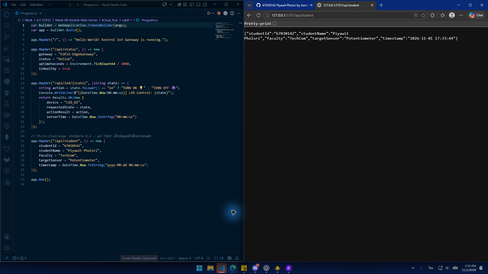
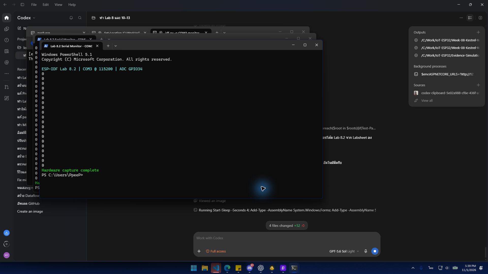
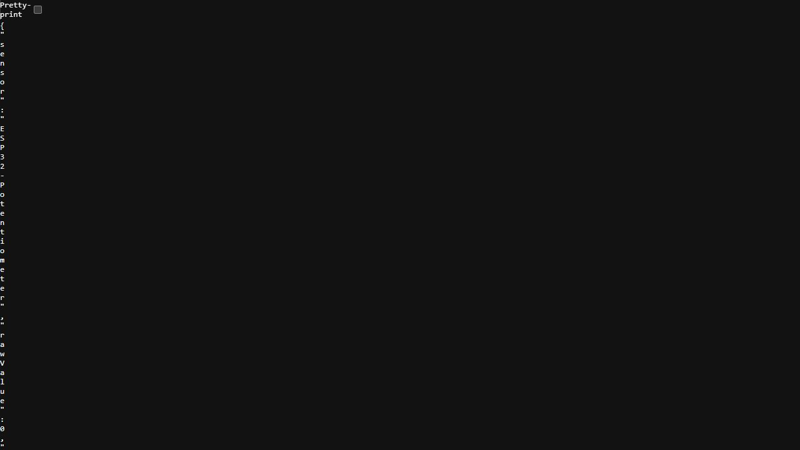
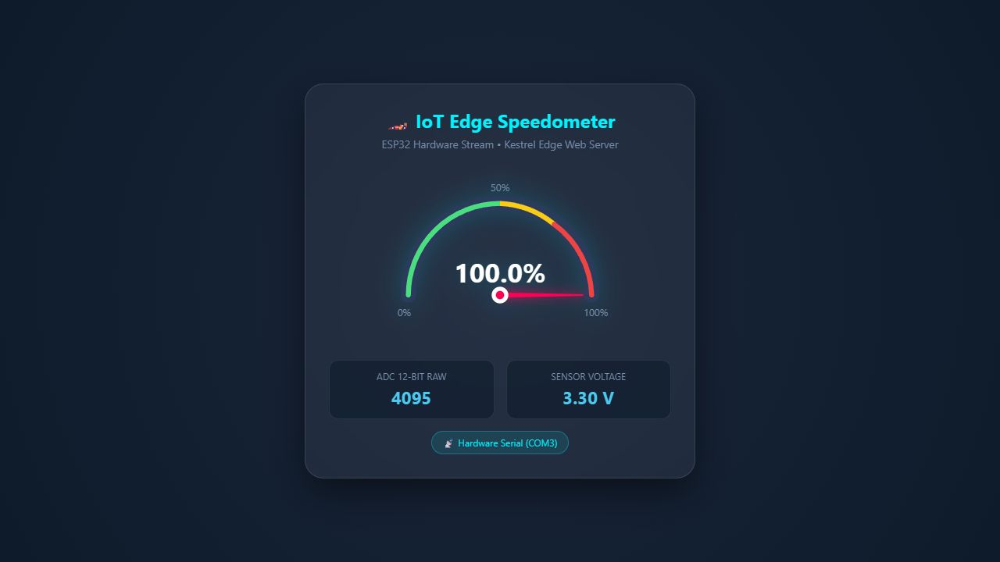
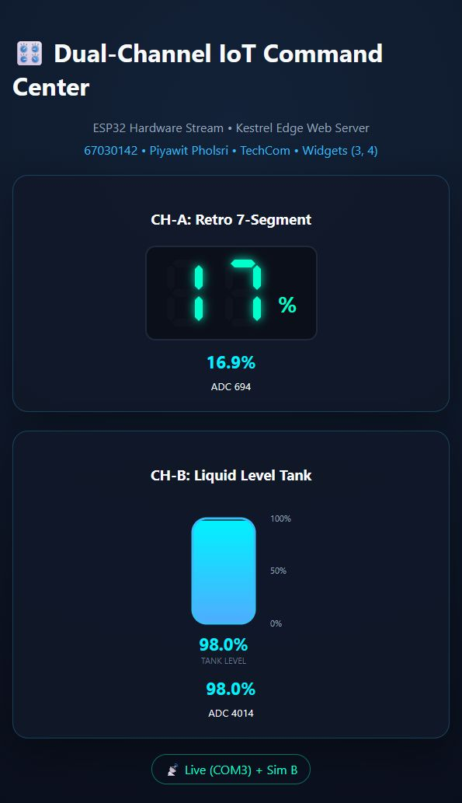

# เฉลย Week 08 แบบสั้น

## Lab 08-1

1. `builder` ใช้ตั้งค่าระบบและเพิ่ม Service ส่วน `app` ใช้กำหนด Route และเริ่ม Web Server
2. Minimal API เขียนน้อย ติดตั้งง่าย และเหมาะกับ IoT Gateway ส่วน LAMP มีเครื่องมือเยอะ แต่ต้องติดตั้งหลายส่วนและจัดการซับซ้อนกว่า
3. `/api/` ช่วยแยกเส้นทางข้อมูลออกจากหน้าเว็บ ทำให้จัดการง่ายและไม่ชนกับ Route อื่น ไม่ใส่ก็ทำงานได้ แต่เมื่อระบบใหญ่ขึ้นจะสับสนง่าย

## ผลจากการรันโค้ดในใบงานจริง

### Lab 8.1 — `/api/student`

> รันจากโค้ด Minimal API ในใบงาน 8.1 โดยใช้รหัส `67030142`, ชื่อ `Piyawit Pholsri` และสาขา `TechCom`

### Lab 8.2 — ESP32 ADC Serial Stream

แฟลชโค้ด `main.c` จาก Labsheet ลง ESP32 จริง แล้วอ่านค่า ADC จาก GPIO34 ผ่าน COM3 ที่ 115200 bps

### Lab 8.3 — `/api/telemetry`

> รันโค้ด Serial Bridge กับ ESP32 จริงที่ COM3 โดย `dataSource` ยืนยันเป็น `Hardware Serial (COM3)` และทดสอบค่าสูงได้ `4095` หรือ `100%` (`DANGER (HIGH)`)

### Lab 8.4 — Interactive SVG Speedometer

> หน้า Dashboard และ SVG มาจากโค้ดใน Labsheet 8.4 โดยอ่าน ESP32 จริงผ่าน COM3 ขณะจับภาพได้ ADC `4095`, `3.30 V`, `100%`

วิดีโอสาธิต Speedometer 18 วินาที: [Lab8-4-Speedometer-Demo-67030142.MOV](Evidence/Lab8-4-Speedometer-Demo-67030142.MOV)

### การคำนวณ Lab 8.5

- เลขสามตัวท้าย `N = 142`
- เกจซ้าย `(142 mod 4) + 1 = 3` → **Retro 7-Segment**
- เกจขวา `(floor(142 / 4) mod 4) + 1 = 4` → **Liquid Level Tank**

หน้าเว็บดึง JSON จาก `/api/telemetry` ทุก 150 ms ฟังก์ชัน `updateLeftWidget()` แปลงเปอร์เซ็นต์จาก ESP32 เป็นตัวเลข 7-Segment และ `updateRightWidget()` ปรับความสูงระดับของเหลวจากช่อง B จำลอง

> ช่อง A อ่าน Potentiometer จริงผ่าน COM3 ส่วนช่อง B เป็นข้อมูลจำลองตามข้อกำหนดใน Labsheet

วิดีโอสาธิต 19 วินาที: [Lab8-5-Demo-67030142.MOV](Evidence/Lab8-5-Demo-67030142.MOV)

