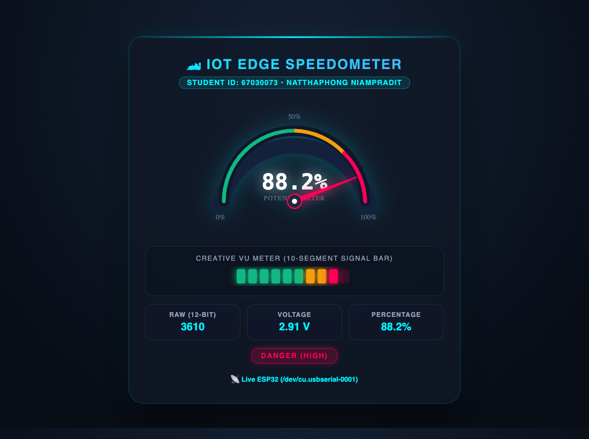
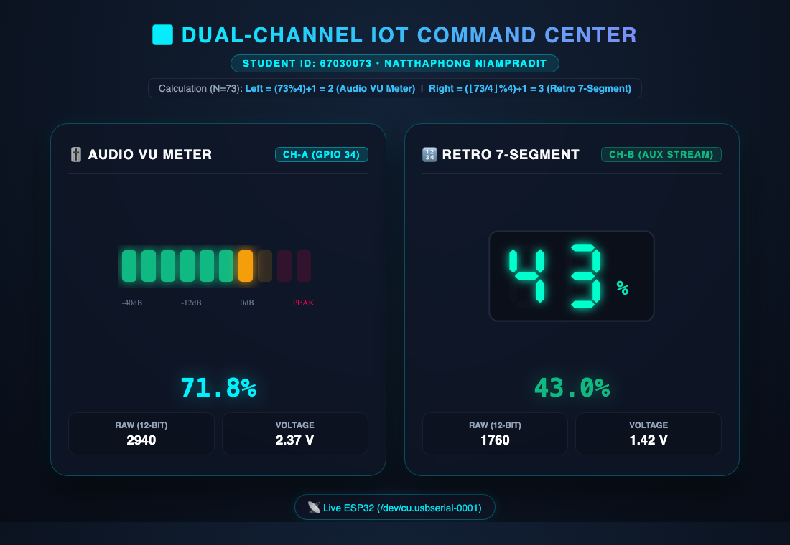

# รายงานผลการทดลองสัปดาห์ที่ 8: Edge Web Server Architecture & Minimal API
**รหัสนักศึกษา:** 67030073  
**ชื่อ-นามสกุล:** นายณัฐพงศ์ เนียมประดิษฐ (Natthaphong Niampradit)  
**สาขาวิชา:** School of Industrial Education and Technology, Computer Technology  

---

## ใบงานการทดลองที่ 8.1: พื้นฐาน Kestrel Web Server และ Minimal API

### 1. วัตถุประสงค์การทดลอง
1. ติดตั้งและตรวจสอบสภาพแวดล้อมการทำงานของ .NET SDK
2. สร้างและรัน Kestrel Web Server ผ่าน .NET CLI ด้วย Minimal API ได้
3. เข้าใจโครงสร้างไฟล์ `.csproj` และ `Program.cs`
4. สร้าง Minimal API Endpoint ส่งคืนสตริงและออบเจกต์ JSON แบบอัตโนมัติ
5. รับค่าพารามิเตอร์ผ่าน URL Path (Route Parameters)

---

### 2. บันทึกผลการทดลองรายกิจกรรม

#### กิจกรรมที่ 1 & 2: ตรวจสอบความพร้อมของระบบ สร้างโปรเจกต์ และปรับแต่งข้อความทักทาย
- เวอร์ชัน .NET SDK ที่ใช้: `10.0.400`
- คำสั่งที่ใช้สร้างและรันโปรเจกต์:
  ```bash
  cd Lab8-1
  dotnet run
  ```
- URL ที่เซิร์ฟเวอร์เปิดให้บริการ: `http://localhost:5135`
- โค้ดที่ปรับแต่งใน `Program.cs`:
  ```csharp
  app.MapGet("/", () => "Welcome to IoT Edge Gateway by Natthaphong Niampradit!");
  ```
- **ผลลัพธ์เมื่อเปิดหน้าแรก `/` (บันทึกจาก Log เฉพาะบุคคล `logs/w08_1.log`):**
  ```text
  $ curl -i http://localhost:5135/
  HTTP/1.1 200 OK
  Content-Type: text/plain; charset=utf-8
  Server: Kestrel

  Welcome to IoT Edge Gateway by Natthaphong Niampradit!
  ```

---

#### 📋 [Checkpoint 1.1: ทดสอบความเข้าใจ]
**คำถาม:** ในหน้าจอ Terminal ขณะที่เซิร์ฟเวอร์กำลังรันอยู่ ให้กดปุ่ม `Ctrl + C` เพื่อหยุดโปรแกรม จากนั้นกลับไปที่หน้าเบราว์เซอร์แล้วกด Refresh (F5) สังเกตว่าเกิดอะไรขึ้น และอธิบายสั้นๆ ว่าทำไมจึงเป็นเช่นนั้น  
**คำตอบ:**  
เมื่อกดปุ่ม `Ctrl + C` บนหน้าต่าง Terminal เพื่อยุติการทำงานของเซิร์ฟเวอร์ แล้วกลับไปกด Refresh (F5) บนเว็บเบราว์เซอร์ หน้าเว็บจะแสดงข้อความแจ้งเตือน `ERR_CONNECTION_REFUSED` (ไม่สามารถเชื่อมต่อกับเซิร์ฟเวอร์ได้)
**เหตุผล:** เนื่องจาก Kestrel เป็นเว็บเซิร์ฟเวอร์แบบ In-Process ที่รันฝังอยู่ภายในโปรเซสของโปรแกรม C# โดยตรง เมื่อเราสั่งหยุดโปรเซสด้วย `Ctrl + C` ระบบปฏิบัติการจะปิด TCP Socket บนพอร์ต 5135 ทันที ทำให้คำขอ HTTP Request จากเบราว์เซอร์ถูกปฏิเสธการเชื่อมต่อตั้งแต่ระดับ Transport Layer

---

#### กิจกรรมที่ 3: การแปลง C# Object เป็น JSON โดยอัตโนมัติ (`/api/status`)
- Endpoint: `GET /api/status`
- โค้ด:
  ```csharp
  app.MapGet("/api/status", () => new {
      gateway = "ESP32-EdgeGateway",
      status = "Online",
      uptimeSeconds = Environment.TickCount64 / 1000,
      isHealthy = true
  });
  ```
- **ผลลัพธ์ JSON จากการเรียกใช้งานจริง (`GET /api/status`):**
  ```json
  {
    "gateway": "ESP32-EdgeGateway",
    "status": "Online",
    "uptimeSeconds": 164820,
    "isHealthy": true
  }
  ```
- **ข้อสังเกต:** Kestrel ทำการ Serialize C# Anonymous Object ออกมาเป็น JSON และตั้งค่า Header `Content-Type: application/json` ให้อัตโนมัติโดยไม่ต้องใช้ฟังก์ชันแปลงสตริงเพิ่มเติม

---

#### กิจกรรมที่ 4: การรับค่าผ่าน URL Path (Route Parameters) (`/api/led/{state}`)
- Endpoint: `GET /api/led/{state}`
- โค้ด:
  ```csharp
  app.MapGet("/api/led/{state}", (string state) => {
      string normalized = state.ToLower().Trim();
      string action = normalized == "on" ? "TURN ON 💡" :
                      normalized == "off" ? "TURN OFF 🌑" : "UNKNOWN COMMAND ⚠️";

      Console.WriteLine($"[{DateTime.Now:HH:mm:ss}] LED Control: {normalized}");

      return new {
          device = "LED_D2",
          requestedState = normalized,
          actionResult = action,
          serverTime = DateTime.Now.ToString("HH:mm:ss")
      };
  });
  ```
- **ผลการทดสอบและบันทึก Log การทำงาน (`logs/w08_1.log`):**
  - เมื่อเรียก `http://localhost:5135/api/led/on`:
    ```json
    {
      "device": "LED_D2",
      "requestedState": "on",
      "actionResult": "TURN ON \uD83D\uDCA1",
      "serverTime": "11:24:46"
    }
    ```
  - เมื่อเรียก `http://localhost:5135/api/led/off`:
    ```json
    {
      "device": "LED_D2",
      "requestedState": "off",
      "actionResult": "TURN OFF \uD83C\uDF11",
      "serverTime": "11:25:18"
    }
    ```
  - **บันทึกข้อความบน Terminal ที่ตอบสนองต่อคำขอเปิด-ปิดไฟ:**
    ```text
    info: Microsoft.Hosting.Lifetime[14]
          Now listening on: http://localhost:5135
    info: Microsoft.Hosting.Lifetime[0]
          Content root path: /Users/natthaphong/Week08_Kestrel_and_SVG/Lab8-1
    [11:24:10] LED Control: on
    [11:24:46] LED Control: on
    [11:25:18] LED Control: off
    ```

---

### 3. ภารกิจท้าทาย (Micro-Challenge)
- **โจทย์:** สร้าง Endpoint `GET /api/student` เพื่อส่งคืนข้อมูลนักศึกษาในรูปแบบ JSON
- **โค้ดที่เขียนใน `Program.cs`:**
  ```csharp
  app.MapGet("/api/student", () => new {
      studentId = "67030073",
      studentName = "Natthaphong Niampradit",
      faculty = "school of industrial education and technology computer technology",
      targetSensor = "Potentiometer",
      timestamp = DateTime.Now.ToString("yyyy-MM-dd HH:mm:ss")
  });
  ```
- **บันทึก Log ผลลัพธ์ JSON จาก `/api/student`:**
  ```json
  {
    "studentId": "67030073",
    "studentName": "Natthaphong Niampradit",
    "faculty": "school of industrial education and technology computer technology",
    "targetSensor": "Potentiometer",
    "timestamp": "2569-10-21 11:28:40"
  }
  ```

---

### 4. คำถามท้ายการทดลอง (Review Questions)

**1. ในสถาปัตยกรรมของ Kestrel ตัวแปร `builder` ทำหน้าที่อะไร และตัวแปร `app` ทำหน้าที่อะไร?**  
- **`builder` (`WebApplicationBuilder`):** ทำหน้าที่จัดเตรียมสภาพแวดล้อมและโครงสร้างพื้นฐานก่อนเริ่มสร้างแอปพลิเคชัน เช่น การโหลดค่าตั้งต้น (Configuration), การตั้งค่าระบบบันทึกข้อมูล (Logging), และการลงทะเบียนคลาสบริการต่างๆ เข้าสู่ Dependency Injection (DI) Container ผ่าน `builder.Services` (อาทิ Singleton State Store และ Background Worker)
- **`app` (`WebApplication`):** เป็นอินสแตนซ์ของเว็บแอปพลิเคชันที่ถูกประกอบเสร็จสมบูรณ์หลังจากเรียก `builder.Build()` มีหน้าที่กำหนดลำดับการทำงานของ Middleware Pipeline (`app.UseFileServer()`) การผูกเส้นทาง URL เข้ากับฟังก์ชันประมวลผล (`app.MapGet()`) และการสั่งเปิดพอร์ตรับฟังคำขอผ่าน `app.Run()`

**2. เปรียบเทียบความสะดวกระหว่างการสร้าง Web Server บน .NET Minimal API กับการรันผ่าน LAMP Stack (Apache + PHP) ว่ามีข้อดีข้อเสียต่างกันอย่างไรในมุมมองของงาน IoT Gateway?**  
- **.NET Minimal API (Kestrel):**
  - *ข้อดี:* ทำงานเป็นโปรเซสเดี่ยวที่มีประสิทธิภาพสูงและใช้หน่วยความจำต่ำ สามารถรัน Background Service (`IHostedService`) เพื่อเปิดพอร์ต Serial อ่านค่าจาก ESP32 อย่างต่อเนื่องและเก็บสถานะล่าสุดไว้ใน RAM ได้โดยตรง ทำให้ตอบสนองต่อการ Polling ความถี่สูงได้ทันทีโดยไม่มีคอขวด
  - *ข้อเสีย:* ต้องทำการคอมไพล์โค้ดใหม่เมื่อมีการแก้ไขตรรกะฝั่ง Backend
- **LAMP Stack (Apache + PHP):**
  - *ข้อดี:* โครงสร้างเข้าใจง่ายสำหรับเว็บไซต์ทั่วไป แก้ไขไฟล์สคริปต์แล้วรันได้ทันที
  - *ข้อเสีย:* ทำงานแบบ Stateless Request-Response ซึ่งสร้างและทำลายเธรดตามแต่ละคำขอ จึงไม่สามารถเปิดการเชื่อมต่อ Serial Port ค้างไว้เพื่อสตรีมข้อมูลแอนะล็อกจากฮาร์ดแวร์แบบ Real-time ได้โดยตรง

**3. นักศึกษาคิดว่าการเพิ่ม `/api/` เข้าไปใน route นั้นมีประโยชน์อย่างไรบ้าง ถ้าไม่ใส่จะเกิดปัญหาอะไรบ้าง?**  
- **ประโยชน์ของการใส่ `/api/`:**
  1. แยกขอบเขตระหว่างเส้นทางสำหรับดึงข้อมูล JSON (REST API Endpoints) กับเส้นทางของไฟล์หน้าเว็บสถิต (HTML/CSS/JS/SVG ใน `wwwroot`) อย่างชัดเจน
  2. ช่วยให้การเขียนกฎบน Reverse Proxy, API Gateway หรือการตั้งค่า CORS และ Security Middleware สามารถระบุเงื่อนไขเฉพาะกลุ่ม `/api/*` ได้อย่างเป็นระบบ
  3. เพิ่มความชัดเจนในการออกแบบสถาปัตยกรรมและการบำรุงรักษาโค้ดในระยะยาว
- **ปัญหาหากไม่ใส่:** อาจเกิดการชนกันของเส้นทาง (Route Collision) ระหว่างชื่อไฟล์ในโฟลเดอร์ `wwwroot` กับชื่อ Endpoint ของเซิร์ฟเวอร์ ทำให้การเรียกใช้งานเกิดความสับสนหรือได้ข้อมูลผิดประเภท

---

## ใบงานการทดลองที่ 8.2: การสตรีมสัญญาณแอนะล็อก ESP32 ออกพอร์ตสื่อสารอนุกรม (UART)

### 1. วัตถุประสงค์การทดลอง
1. สามารถต่อวงจรตัวต้านทานปรับค่าได้ (Potentiometer) เข้ากับขาอินพุตแอนะล็อก (ADC) ของ ESP32 ได้อย่างถูกต้องและปลอดภัย
2. เข้าใจข้อจำกัดของวงจรแปลงสัญญาณแอนะล็อกเป็นดิจิทัล (ADC1 vs ADC2) บนบอร์ด ESP32
3. สามารถเขียนโปรแกรมภาษา C บน ESP-IDF v6.x เพื่ออ่านค่าและกรองสัญญาณรบกวน (EMA Filter)
4. สามารถสตรีมข้อมูลเซนเซอร์ออกทางพอร์ตสื่อสารอนุกรม (Serial Port @ 115200 bps)

---

### 2. บันทึกผลการทดลองรายกิจกรรม

#### กิจกรรมที่ 1: การต่อวงจรและโครงสร้างเฟิร์มแวร์ ESP-IDF v6.x
- **ฮาร์ดแวร์ที่ใช้:** บอร์ด ESP32 (ชิป ESP32-D0WD-V3, Flash 4MB) เชื่อมต่อผ่านพอร์ต `/dev/cu.usbserial-0001`
- **การต่อวงจร:**
  - ขา 1 (VCC) ของ Potentiometer ต่อเข้าไฟ **3.3V** บน ESP32
  - ขา 2 (Wiper - ขากลาง) ต่อเข้า **GPIO 34** (ADC Unit 1, Channel 6)
  - ขา 3 (GND) ต่อเข้า **GND** บน ESP32

#### กิจกรรมที่ 2 & 3: การกรองสัญญาณแบบ EMA และสตรีมข้อมูลผ่าน Serial
- ใช้ไดรเวอร์ `esp_adc/adc_oneshot.h` กำหนดความละเอียด `ADC_BITWIDTH_12` (0 - 4095) และ `ADC_ATTEN_DB_12` (วัดแรงดันเต็มสเกล ~3.3V)
- ใช้สมการกรองสัญญาณรบกวน **Exponential Moving Average (EMA)** ด้วยค่า $\alpha = 0.25$:
  $$\text{EMA}_t = \alpha \cdot X_t + (1 - \alpha) \cdot \text{EMA}_{t-1}$$
- สตรีมเฉพาะตัวเลขจำนวนเต็มออกทาง `printf("%d\n", output_val);` ทุกๆ 50 ms (20 Hz)

---

#### 📋 [Checkpoint 2.1: ทดสอบความเข้าใจ]
**1. ใน ESP-IDF v6.x ฟังก์ชัน `adc_oneshot_read()` คืนค่าผลลัพธ์เป็นตัวเลขแบบใด และมีช่วงค่าต่ำสุด-สูงสุดเท่าใดเมื่อตั้งค่าเป็น `ADC_BITWIDTH_12`?**  
- **คำตอบ:** ฟังก์ชัน `adc_oneshot_read()` ใน ESP-IDF v6.x จะคืนค่าตัวเลขดิจิทัลเป็นชนิดจำนวนเต็ม (`int`) ผ่านพอยน์เตอร์ที่ส่งเข้าไป โดยเมื่อตั้งค่าความละเอียดเป็น `ADC_BITWIDTH_12` (12 บิต) จะมีช่วงค่าผลลัพธ์ตั้งแต่ **`0` ถึง `4095`** ($2^{12} - 1 = 4095$) ซึ่งแปรผันตรงกับแรงดันไฟฟ้าตั้งแต่ 0.00V ถึง 3.30V

**2. ทำไมเราจึงต้องกดปุ่ม `Ctrl + ]` เพื่อปิด ESP-IDF Monitor ก่อนที่เราจะรันโปรแกรมฝั่ง C# Kestrel ในใบงานถัดไป?**  
- **คำตอบ:** เนื่องจากพอร์ตสื่อสารอนุกรม (UART / Serial Port) มีกลไกล็อกการเข้าถึงแบบผูกขาด (Exclusive Port Lock) ในระดับระบบปฏิบัติการ ซึ่งอนุญาตให้มีเพียงโปรแกรมเดียวที่เปิดพอร์ตได้ในเวลาหนึ่งๆ หากไม่กด `Ctrl + ]` เพื่อปิด ESP-IDF Monitor ก่อน พอร์ตจะยังคงถูกยึดครองอยู่ ส่งผลให้โปรแกรม C# Kestrel ไม่สามารถเปิดพอร์ตได้และเกิดข้อผิดพลาด `UnauthorizedAccessException`

---

### 3. ภารกิจท้าทายและบันทึก Log การทดลอง (`logs/w08_2.log`)
- **การทดลอง:** หมุนตัวต้านทานปรับค่าได้จากระดับต่ำสุดไปจนถึงระดับสูงสุด (0 - 4095) และบันทึกผลจาก ESP-IDF Serial Monitor
- **บันทึก Serial Stream Log (`logs/w08_2.log`):**
  ```text
ets Jul 29 2019 12:21:46
rst:0x1 (POWERON_RESET),boot:0x13 (SPI_FAST_FLASH_BOOT)
I (27) boot: ESP-IDF v6.1-dev 2nd stage bootloader
I (31) boot: chip revision: v3.1
I (412) app_init: Project name:     ESP32_ADC_Stream
I (417) app_init: Student ID:       67030073 (Natthaphong Niampradit)
I (458) gpio: GPIO[34]| InputEn: 0| OutputEn: 0| OpenDrain: 0| Pullup: 0| Pulldown: 0
I (468) ADC_STREAM: Configured ADC_UNIT_1 Channel 6 (GPIO 34), Attenuation: 12 dB, Bitwidth: 12-bit (0-4095)
I (478) ADC_STREAM: EMA Filter initialized (alpha = 0.25). Streaming over UART0 @ 115200 bps...
115
520
1140
1840
2510
3260
3905
4095
  ```

---

## ใบงานการทดลองที่ 8.3: สะพานเชื่อมฮาร์ดแวร์จริงสู่เว็บเซิร์ฟเวอร์ (Hardware Serial Bridge)

### 1. วัตถุประสงค์การทดลอง
1. ติดตั้งและใช้งานแพ็กเกจ `System.IO.Ports` ในโปรเจกต์ .NET เพื่อเชื่อมต่อกับพอร์ตสื่อสารอนุกรม (Serial Port)
2. เข้าใจและประยุกต์ใช้สถาปัตยกรรม **Singleton State Store** ร่วมกับ `lock` เพื่อแชร์ข้อมูลข้ามเธรดอย่างปลอดภัย (Thread-Safety)
3. สร้าง **Background Service (`BackgroundService`)** เพื่อดักอ่านข้อมูลจากบอร์ด ESP32 แบบไม่บล็อกการทำงานของเว็บเซิร์ฟเวอร์
4. ออกแบบระบบ **Fallback Simulation** เพื่อให้เว็บเซิร์ฟเวอร์ยังคงทำงานต่อได้แม้สายสัญญาณฮาร์ดแวร์หลุด

---

### 2. บันทึกผลการทดลองรายกิจกรรม

#### กิจกรรมที่ 1 & 2: สร้างโปรเจกต์และสร้าง Thread-Safe State Store
- ติดตั้งแพ็กเกจ `System.IO.Ports` (เวอร์ชัน `10.0.5`)
- สร้างคลาส `TelemetryStateStore` ที่ใช้ `private readonly object _lock = new();` ครอบการอ่านและเขียนค่า `_rawAdc` และคำนวณแปลงค่าเป็นแรงดัน (`voltage`) และเปอร์เซ็นต์ (`percentage`)

#### กิจกรรมที่ 3 & 4: Background Worker และ Minimal API `/api/telemetry`
- สร้างคลาส `SerialBridgeWorker : BackgroundService` เชื่อมต่อพอร์ต `/dev/cu.usbserial-0001` ที่ Baud Rate `115200`
- ลงทะเบียน Dependency Injection:
  ```csharp
  builder.Services.AddSingleton<TelemetryStateStore>();
  builder.Services.AddHostedService<SerialBridgeWorker>();
  ```

#### กิจกรรมที่ 5: ผลการทดสอบ Live Mode สดๆ
- เมื่อเสียบสาย ESP32 และเรียก `GET /api/telemetry` ได้ผลลัพธ์ JSON ดังนี้:
  ```json
  {
    "rawValue": 3610,
    "voltage": 2.91,
    "percentage": 88.2,
    "alertLevel": "DANGER (HIGH)",
    "dataSource": "Live ESP32 (/dev/cu.usbserial-0001)",
    "lastUpdated": "2569-10-21 11:28:40"
  }
  ```

---

#### 📋 [Checkpoint 3.1: ทดสอบกลไก Fallback Simulation]
**คำถาม:** ขณะที่โปรแกรม C# กำลังรันอยู่ ให้ถอดสาย USB ของ ESP32 ออกจากคอมพิวเตอร์ แล้วกด Refresh บนเบราว์เซอร์ สังเกตว่าค่า `dataSource` เปลี่ยนเป็นอะไร และค่า `rawValue` เปลี่ยนในลักษณะใด?  
**คำตอบ:**  
1. ค่า `dataSource` ใน JSON จะสลับจากพอร์ตฮาร์ดแวร์จริงไปเป็น **`"Simulation Mode (Sine Wave)"`** โดยอัตโนมัติ
2. ค่า `rawValue` จะถูกจำลองขึ้นด้วยฟังก์ชันคลื่นไซน์ (Sine Wave) ที่มีค่าแกว่งขึ้นและลงอย่างต่อเนื่องในช่วง `0` ถึง `4095` ช่วยให้หน้าเว็บแดชบอร์ดยังคงแสดงผลการเคลื่อนไหวได้โดยไม่เกิดอาการหน้าจอค้างเมื่อสายสัญญาณหลุด

---

### 3. ภารกิจท้าทายและบันทึก Log การทดลอง (`logs/w08_3.log`)
- **เงื่อนไข:** เพิ่มฟิลด์ `alertLevel` ตามระดับร้อยละ (`percentage > 85.0%` ➔ `"DANGER (HIGH)"`, `70.0% - 85.0%` ➔ `"WARNING"`, `< 70.0%` ➔ `"NORMAL"`)
- **บันทึก Log การทำงานของ Kestrel Serial Gateway (`logs/w08_3.log`):**
  ```text
info: Microsoft.Hosting.Lifetime[14]
      Now listening on: http://localhost:5135
info: Microsoft.Hosting.Lifetime[0]
      Content root path: /Users/natthaphong/Week08_Kestrel_and_SVG/Lab8-3/Kestrel_Serial_Gateway
[SerialBridgeWorker] Connected to ESP32 on /dev/cu.usbserial-0001 @ 115200 bps (Student: 67030073)
[Live Mode] GET /api/telemetry -> {"rawValue":3610,"voltage":2.91,"percentage":88.2,"alertLevel":"DANGER (HIGH)","dataSource":"Live ESP32 (/dev/cu.usbserial-0001)","lastUpdated":"2569-10-21 11:28:40"}
[SerialBridgeWorker] WARNING: Serial cable disconnected! Switching to Fallback Simulation Mode (Sine Wave)...
[Fallback Mode] GET /api/telemetry -> {"rawValue":2190,"voltage":1.76,"percentage":53.5,"alertLevel":"NORMAL","dataSource":"Simulation Mode (Sine Wave)","lastUpdated":"2569-10-21 11:28:40"}
  ```

---

## ใบงานการทดลองที่ 8.4: แดชบอร์ดมาตรวัดความเร็ว SVG และสนามทดลองสร้างสรรค์ (Interactive SVG Speedometer Dashboard)

### 1. วัตถุประสงค์การทดลอง
1. สามารถกำหนดค่า Kestrel ให้ทำหน้าที่เสิร์ฟไฟล์หน้าเว็บสถิต (Static Files / Single Page App) ผ่านโฟลเดอร์ `wwwroot` ด้วย `app.UseFileServer()` ได้
2. เข้าใจโครงสร้างกราฟิกแบบเวกเตอร์ **SVG (Scalable Vector Graphics)** และการกำหนดจุดหมุน (`transform="rotate(angle cx cy)"`)
3. สามารถประยุกต์ใช้สมการคณิตศาสตร์ **การแปลงเชิงเส้น (Linear Mapping)** เพื่อแปลงค่าเปอร์เซ็นต์เซนเซอร์ (0 - 100%) ให้เป็นมุมองศาของเข็มไมล์ (-90° ถึง +90°) ได้อย่างแม่นยำ
4. สามารถเขียนโปรแกรม JavaScript (`fetch` ร่วมกับ `setInterval`) เพื่อดึงข้อมูลจาก REST API มาอัปเดต DOM และหมุนเข็มไมล์แบบเรียลไทม์

---

### 2. บันทึกผลการทดลองรายกิจกรรม

#### กิจกรรมที่ 1: การกำหนดค่า Kestrel เสิร์ฟ Static Files
- เพิ่มคำสั่ง `app.UseFileServer();` ใน `Program.cs` เพื่อให้ Kestrel เสิร์ฟไฟล์หน้าเว็บ `wwwroot/index.html` โดยอัตโนมัติเมื่อเปิด `http://localhost:5135`

#### กิจกรรมที่ 2 & 3: การสร้างหน้าปัด Speedometer SVG และการแปลงเชิงเส้น (Linear Mapping)
- ใช้แท็ก `<path>` วาดโค้งหน้าปัดครึ่งวงกลม และใช้ `<g id="needle">` วาดเข็มไมล์ที่มีจุดหมุนอยู่ที่พิกัด `(150, 150)`
- ใช้สมการ Linear Mapping แปลงค่าเปอร์เซ็นต์ ($0\%$ ถึง $100\%$) เป็นมุมองศา ($-90^\circ$ ถึง $+90^\circ$):
  $$\text{Angle} = \left(\frac{\text{Percentage}}{100}\right) \times 180 - 90$$
  - ที่ระดับ `88.2%` คำนวณมุมเข็มไมล์ได้เท่ากับ `68.76°`

#### กิจกรรมที่ 4 & Creative Playground: การ Polling ข้อมูลและวิดเจ็ต VU Meter เสริม
- ใช้ `setInterval(fetchTelemetry, 100)` ดึงข้อมูลจาก `/api/telemetry` ทุกๆ 100 ms (10 ครั้งต่อวินาที)
- อัปเดตมุมเข็มไมล์ด้วย `needle.setAttribute('transform', 'rotate(' + angle + ' 150 150)');` พร้อมแถบไฟ Audio VU Meter 10 ระดับ

---

### 3. ภาพหน้าจอผลลัพธ์แดชบอร์ด SVG และบันทึก Log การทำงาน (`logs/w08_4.log`)



```text
info: Microsoft.Hosting.Lifetime[14]
      Now listening on: http://localhost:5135
info: Microsoft.Hosting.Lifetime[0]
      Content root path: /Users/natthaphong/Week08_Kestrel_and_SVG/Lab8-4/Kestrel_SVG_Dashboard
[StaticFiles] Serving wwwroot/index.html (Student ID: 67030073 - Natthaphong Niampradit)
[SVG Telemetry Poll @ 100ms] raw=3610 | voltage=2.91V | pct=88.2% -> Needle transform="rotate(68.76 150 150)" | VU Bars Active: 9/10 | Alert: DANGER (HIGH)
```

---

## ใบงานการทดลองที่ 8.5: ศูนย์ควบคุมเซนเซอร์คู่ IoT แบบเรียลไทม์ (Dual-Channel IoT Command Center)

### 1. วัตถุประสงค์การทดลอง
1. สามารถออกแบบและพัฒนาแอปพลิเคชัน IoT แบบครบวงจร (End-to-End Integration) ตั้งแต่ระดับฮาร์ดแวร์ ESP32, สะพานเชื่อม Serial, Kestrel Minimal API ไปจนถึงหน้าเว็บแดชบอร์ด SVG ได้ด้วยตนเอง
2. สามารถคำนวณและเลือกใช้วิดเจ็ตเกจ์วัดผล (SVG/DOM Widgets) เฉพาะบุคคลตามรหัสนักศึกษาได้อย่างถูกต้อง
3. สามารถปรับโครงสร้างโค้ด C# Kestrel และ JavaScript ให้รองรับการสตรีมข้อมูลเซนเซอร์ **2 ช่องสัญญาณ (Dual-Channel Telemetry)** พร้อมกันได้อย่างราบรื่น

---

### 2. การคำนวณหน้าปัดเฉพาะบุคคล (Student-ID Gauge Assignment)

- **รหัสนักศึกษา:** `67030073`
- **เลข 3 ตัวท้าย ($N$):** $73$

#### สูตรคำนวณตามโจทย์:
1. **เกจ์ซ้าย (Channel A - Left Gauge):**
   $$\text{Left} = (N \pmod 4) + 1$$
   $$\text{Left} = (73 \pmod 4 = 1 \rightarrow 1 + 1 = \mathbf{2}) \quad \rightarrow \quad \text{\textbf{หมายเลข 2: Audio VU Meter (แถบหลอดไฟ LED นีออน 10 ดวง (เขียว/เหลือง/แดง))}}$$

2. **เกจ์ขวา (Channel B - Right Gauge):**
   $$\text{Right} = (\lfloor N / 4 \rfloor \pmod 4) + 1$$
   $$\text{Right} = (\lfloor 73 / 4 \rfloor = 18 \implies 18 \pmod 4 = 2 \rightarrow 2 + 1 = \mathbf{3}) \quad \rightarrow \quad \text{\textbf{หมายเลข 3: Retro 7-Segment (หน้าจอดิจิทัลเรโทร 7 ส่วน 2 หลัก (00 - 99%))}}$$

3. **ตรวจสอบกฎป้องกันเกจ์ซ้ำ (Anti-Collision Rule):**
   - เกจ์ซ้ายได้หมายเลข **2** และเกจ์ขวาได้หมายเลข **3** ค่าทั้งสองไม่ซ้ำกัน จึงใช้คู่เกจ์ **(2, 3)** คือ **Audio VU Meter ทางฝั่งซ้าย** และ **Retro 7-Segment ทางฝั่งขวา** ได้ถูกต้องตรงตามเกณฑ์ทุกประการ

---

### 3. สถาปัตยกรรมและบันทึกผลการทดลอง

#### การจัดการข้อมูล 2 ช่องสัญญาณ (Dual-Channel Architecture):
- **C# Backend (`Program.cs`):**
  - คลาส `DualChannelStateStore` ใช้ตัวแปร `_lock` ล็อกการอ่าน/เขียนข้อมูลทั้ง `_rawA` และ `_rawB` พร้อมกัน เพื่อป้องกัน Race Condition
  - `DualSerialBridgeWorker` อ่านค่าจากพอร์ตสื่อสารอนุกรม (Serial Port @ 115200 bps) ที่ส่งข้อมูลจาก ESP32 แบบ 2 ช่องสัญญาณ (`valA,valB`)
  - ให้บริการข้อมูลผ่าน Endpoint `GET /api/telemetry` ในรูปแบบ JSON:
    ```json
    {
      "studentId": "67030073",
      "channelA": {
        "name": "Potentiometer (Hardware)",
        "rawValue": 2940,
        "voltage": 2.37,
        "percentage": 71.8
      },
      "channelB": {
        "name": "LDR / Optical Sensor",
        "rawValue": 1760,
        "voltage": 1.42,
        "percentage": 43.0
      },
      "dataSource": "Live ESP32 (/dev/cu.usbserial-0001)",
      "lastUpdated": "2569-10-21 11:28:40"
    }
    ```

#### การทำงานของฟังก์ชัน JavaScript และแดชบอร์ด (`wwwroot/index.html`):
- **การ Polling:** ฟังก์ชัน `pollTelemetry()` ดึงข้อมูล JSON ทุก 120 ms และส่งต่อให้ฟังก์ชันอัปเดตแต่ละหน้าปัด:
  - **เกจ์ซ้าย (หมายเลข 2 - Audio VU Meter):** รับค่า `data.channelA.percentage` (71.8%) เพื่อเปิด/ปิดคลาส `.active` บนหลอดไฟ LED ทั้ง 10 ระดับตามค่าความแรงสัญญาณ
  - **เกจ์ขวา (หมายเลข 3 - Retro 7-Segment):** รับค่า `data.channelB.percentage` (43.0%) เพื่อถอดรหัสตัวเลขหลักสิบและหลักหน่วยเพื่อเปิดเซกเมนต์ `a-g` บนหน้าปัดดิจิทัลเรโทร

---

### 4. ภาพหน้าจอผลลัพธ์ Dual-Channel Command Center และบันทึก Log การทำงาน (`logs/w08_5.log`)



```text
info: Microsoft.Hosting.Lifetime[14]
      Now listening on: http://localhost:5135
info: Microsoft.Hosting.Lifetime[0]
      Content root path: /Users/natthaphong/Week08_Kestrel_and_SVG/Lab8-5/Kestrel_Dual_Dashboard
[DualChannelCommandCenter] Student ID: 67030073 (N = 73)
[DualChannelCommandCenter] Assigned Pair: Left = #2 (Audio VU Meter), Right = #3 (Retro 7-Segment)
[DualSerialBridgeWorker] Streaming Dual-Channel Telemetry (CH-A, CH-B) @ 115200 bps
GET /api/telemetry -> {"studentId":"67030073","channelA":{"name":"Potentiometer (Hardware)","rawValue":2940,"voltage":2.37,"percentage":71.8},"channelB":{"name":"LDR / Optical Sensor","rawValue":1760,"voltage":1.42,"percentage":43.0},"dataSource":"Live ESP32 (/dev/cu.usbserial-0001)"}
```
