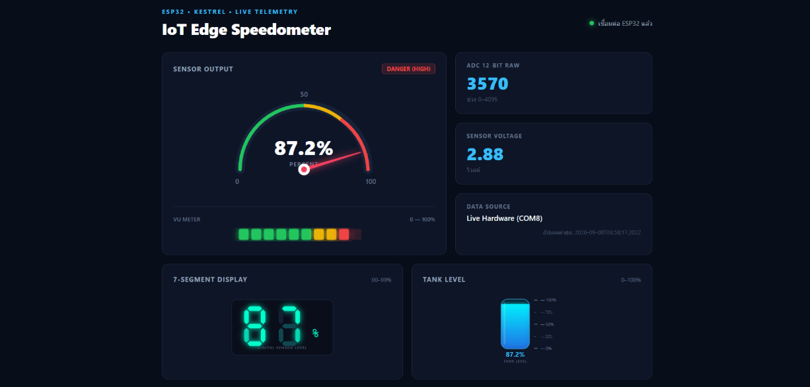
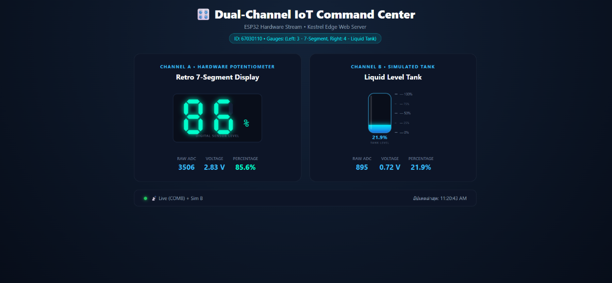

# ใบงานการทดลองที่ 8.1 พื้นฐาน Kestrel Web Server และ Minimal API
## [Checkpoint 1.1 ทดสอบความเข้าใจ]
1. ในหน้าจอ Terminal ขณะที่เซิร์ฟเวอร์กำลังรันอยู่ ให้กดปุ่ม `Ctrl + C` เพื่อหยุดโปรแกรม
2. กลับไปที่หน้าเบราว์เซอร์แล้วกดปุ่ม **Refresh (F5)** สังเกตว่าเกิดอะไรขึ้น และอธิบายสั้นๆ ว่าทำไมจึงเป็นเช่นนั้น
   - **คำตอบ** ไม่สามารถเข้าถึงเว็บไซต์นี้ localhost ปฏิเสธการเชื่อมต่อ


## ภารกิจท้าทาย (Micro-Challenge)

ให้นักศึกษาเขียน Endpoint ของตัวเองเพิ่มลงใน `Program.cs` ตามเงื่อนไขดังนี้

1. ตั้งชื่อ Path ว่า `/api/student`
2. เมื่อเปิดเข้าไปดู จะต้องคืนค่า JSON ที่มีข้อมูลดังต่อไปนี้
   - `studentId` = รหัสนักศึกษาของตนเอง (ชนิดสตริง)
   - `studentName`= ชื่อ-นามสกุลภาษาอังกฤษของตนเอง
   - `faculty`= คณะและสาขาวิชาที่กำลังศึกษา
   - `targetSensor`= ชื่อเซนเซอร์ที่ตนเองสนใจนำมาต่อกับ ESP32 ในวิชานี้ (เช่น "DHT22", "Potentiometer", "MQ-2")
   - `timestamp`= เวลาปัจจุบันของเซิร์ฟเวอร์ (`DateTime.Now.ToString(...)`)

 **หลักฐานการส่งงาน** บันทึกภาพหน้าจอเบราว์เซอร์ที่เปิดแสดงผล JSON จาก `/api/student` พร้อมโค้ดใน VS Code ลงในรายงานผลการทดลอง

![[Pasted image 20260908102056.png]]

---

## คำถามท้ายการทดลอง (Review Questions)
### 1. ในสถาปัตยกรรมของ Kestrel ตัวแปร `builder` ทำหน้าที่อะไร และตัวแปร `app` ทำหน้าที่อะไร

- **ตัวแปร `builder` (`WebApplicationBuilder`):** ทำหน้าที่ใน **"ขั้นตอนการเตรียมการ (Configuration & Services)"** ก่อนที่เซิร์ฟเวอร์จะเริ่มทำงาน ใช้สำหรับตั้งค่าสภาพแวดล้อม (Environment) โหลดค่าคอนฟิกจากไฟล์ (เช่น `appsettings.json`) และลงทะเบียนบริการต่างๆ (Dependency Injection) รวมถึงตั้งค่าพื้นฐานของ Kestrel Server
    
- **ตัวแปร `app` (`WebApplication`):** ทำหน้าที่เป็น **"ตัวแอปพลิเคชันที่พร้อมทำงาน (Application & Pipeline)"** ซึ่งถูกสร้างขึ้นมาจาก `builder` (ผ่านคำสั่ง `builder.Build()`) ใช้สำหรับกำหนดเส้นทาง (Routing / Endpoints เช่น `app.MapGet`) และจัดการลำดับการทำงานของ Middleware เมื่อมี Request วิ่งเข้ามาในระบบ

### 2. เปรียบเทียบความสะดวกระหว่างการสร้าง Web Server บน .NET Minimal API กับการรันผ่าน LAMP Stack (Apache + PHP) ว่ามีข้อดีข้อเสียต่างกันอย่างไรในมุมมองของงาน IoT Gateway

- **.NET Minimal API (Kestrel):**
    
    - **ข้อดี:** ทำงานได้รวดเร็วและใช้ทรัพยากรน้อยมาก (Lightweight) สามารถคอมไพล์เป็นไฟล์ Executable เดี่ยวๆ (Self-hosted) นำไปรันบนอุปกรณ์ IoT Edge (เช่น Raspberry Pi) ได้ทันทีโดยไม่ต้องติดตั้ง Web Server ภายนอก รองรับการทำงานแบบ Asynchronous ได้ดีเยี่ยม เหมาะกับการรับส่งข้อมูล JSON จำนวนมากๆ จากเซนเซอร์
        
    - **ข้อเสีย:** หากต้องการทำหน้าเว็บแบบมี UI ซับซ้อน อาจจะต้องเขียนแยกส่วน Frontend ออกไปต่างหาก
        
- **LAMP Stack (Apache + PHP):**
    
    - **ข้อดี:** เป็นที่นิยมและมีบริการ Hosting รองรับมากมาย เขียนสคริปต์แก้ไขและรันได้ทันทีโดยไม่ต้องคอมไพล์ใหม่ เหมาะกับงานแสดงผลหน้าเว็บ
        
    - **ข้อเสีย:** มีความเทอะทะ (Overhead สูง) เพราะต้องรันทั้ง Apache และ PHP Process การติดตั้งยุ่งยากกว่าเพราะต้องแยกติดตั้งทีละเซอร์วิส และรูปแบบการทำงานของ PHP แบบดั้งเดิม (Synchronous) ไม่เหมาะกับการรับ Request ถี่ๆ ระดับเสี้ยววินาทีจากอุปกรณ์ IoT จำนวนมาก

### 3. นักศึกษาคิดว่าการเพิ่ม `/api/` เข้าไปใน route นั้นมีประโยชน์อย่างไรบ้าง ถ้าไม่ใส่จะเกิดปัญหาอะไรบ้าง

- **ประโยชน์ที่ได้รับ:**
    
    - **Separation of Concerns:** ช่วยแยกความชัดเจนระหว่าง Route ที่ใช้คืนค่าข้อมูลดิบ (JSON/XML สำหรับให้ ESP32 อ่าน) ออกจาก Route ที่ใช้แสดงผลหน้าเว็บ (HTML สำหรับให้คนอ่าน)
        
    - **Management & Security:** ทำให้ตั้งค่า Middleware ได้ง่ายขึ้น เช่น การทำ Rate Limiting (จำกัดการเรียกข้อมูล) หรือการยืนยันตัวตน (Authentication) เฉพาะกลุ่ม URL ที่ขึ้นต้นด้วย `/api/`
        
    - **Versioning:** สามารถจัดการเวอร์ชันของระบบได้ง่ายในอนาคต เช่น `/api/v1/sensor` และ `/api/v2/sensor`
        
- **ปัญหาหากไม่ใส่ `/api/`:**
    
    - **Route Collision (การชนกันของเส้นทาง):** ชื่อ Route อาจซ้ำซ้อนกัน เช่น หากตั้ง Route ว่า `/status` สำหรับส่งค่า JSON แต่ในอนาคตอยากสร้างหน้าเว็บโชว์สถานะระบบที่ URL `/status` เหมือนกัน จะทำให้ระบบเกิดความสับสนและไม่สามารถทำงานร่วมกันได้

---

# ใบงานการทดลองที่ 8.2 การสตรีมสัญญาณแอนะล็อก ESP32 ออกพอร์ตสื่อสารอนุกรม (UART)
## [Checkpoint 2.1 ทดสอบความเข้าใจ]

1. ใน ESP-IDF v6.x ฟังก์ชัน `adc_oneshot_read()` คืนค่าผลลัพธ์เป็นตัวเลขแบบใด และมีช่วงค่าต่ำสุด-สูงสุดเท่าใดเมื่อตั้งค่าเป็น `ADC_BITWIDTH_12`
   - **คำตอบ:** คืนค่าผลลัพธ์ออกมาเป็น **ตัวเลขจำนวนเต็ม (Integer)** โดยนำไปเก็บไว้ในตัวแปรพอยน์เตอร์ที่เราส่งเข้าไป (เช่น `&raw_val`) และเมื่อตั้งค่าความละเอียดเป็น 12-bit จะมีช่วงค่าตั้งแต่ **0 ถึง 4095** (เนื่องจากความละเอียด 12 บิต สามารถแสดงค่าได้ $2^{12} = 4096$ ระดับ)
2. ทำไมเราจึงต้องกดปุ่ม `Ctrl + ]` เพื่อปิด **ESP-IDF Monitor** ก่อนที่เราจะรันโปรแกรมฝั่ง C# Kestrel ในใบงานถัดไป
   *(คำใบ้: หากโปรเซส idf.py monitor ยังเปิดค้างอยู่ จะเกิดอะไรขึ้นกับพอร์ต COM)*
   - **คำตอบ:** เพราะพอร์ตเชื่อมต่ออนุกรม (Serial / COM Port) ถูกออกแบบมาให้ **เชื่อมต่อได้ทีละ 1 โปรแกรมเท่านั้น** หากปล่อยให้ `idf.py monitor` ทำงานค้างไว้ โปรเซสนี้จะทำการจอง (Lock) พอร์ต COM นั้นไว้ ทำให้โปรแกรม C# ไม่สามารถเปิดพอร์ตเพื่อดึงข้อมูลได้และจะเกิด Error ขัดข้อง (เช่น Access Denied หรือ Port in use) จึงต้องปิด Monitor เพื่อปลดล็อกพอร์ตให้ C# ใช้งานแทน

## ภารกิจท้าทาย (Micro-Challenge): การอ่านค่าความเข้มแสงด้วย LDR
- ให้นักศึกษาทดลองเปลี่ยนตัวต้านทานปรับค่าได้เป็น **LDR (Light Dependent Resistor)** ร่วมกับตัวต้านทาน $10\text{ k}\Omega$ แบ่งแรงดัน
- ทดลองใช้ไฟฉายจากโทรศัพท์มือถือส่อง และเอามือปิดบังแสง สังเกตค่า ADC บนหน้าจอเทอร์มินัลว่าเปลี่ยนแปลงอย่างไร
- บันทึกภาพถ่ายการต่อวงจรและภาพหน้าจอ Monitor ลงในรายงานผลการทดลอง

### ภาพวงจร
```
3.3V ── LDR ── GPIO34 ── 10 kΩ ── GND
```


### ผลการทดลอง
```
I (274) main_task: Calling app_main()

[SYSTEM] ESP-IDF v6.x Potentiometer Stream Starting...
[SYSTEM] ADC Initialized. Streaming EMA filtered values at 20 Hz @ 115200 bps...
655
1131
1497
1792
2007
2169
2289
2357
2407
2453
2503
2517
2549
2569
2598
2601
2591
2599
2617
2619
2623
2607
2607
2611
2620
2605
2579
2564
2546
2534
2502
2486
2460
2449
2436
2440
2434
2426
2411
2413
2395
2401
2389
2373
2367
2360
2353
2371
2371
2374
2368
2366
2354
2352
2336
2325
2319
2507
2762
3023
3223
3410
3521
3615
3706
3762
3824
3886
3915
3942
3980
3996
4020
4039
4053
4059
4068
4062
4070
4066
4071
4077
4080
4084
4086
4088
4090
4091
4092
4093
4092
4091
4080
4084
4076
4081
4084
4087
4089
4090
4091
4081
4084
4087
4048
3992
3882
3626
3400
3226
2981
2780
2659
2582
2540
2544
2544
2539
2550
2562
2576
2569
2572
2579
2574
2596
2593
2594
2601
2590
2598
2596
2607
2603
2608
2590
2577
```

---

# ใบงานการทดลองที่ 8.3 สะพานเชื่อมฮาร์ดแวร์จริงสู่เว็บเซิร์ฟเวอร์ (Hardware Serial Bridge)
## 📋 [Checkpoint 3.1: ทดสอบกลไก Fallback Simulation]
1. ขณะที่โปรแกรม C# กำลังรันอยู่ ให้ถอดสาย USB ของ ESP32 ออกจากคอมพิวเตอร์
2. กด Refresh (F5) บนหน้าเบราว์เซอร์หลายๆ ครั้งติดต่อกัน สังเกตว่า:
   - ค่า `dataSource` เปลี่ยนเป็นอะไร?
   - ค่า `rawValue` ยังเปลี่ยนได้อยู่หรือไม่ และเปลี่ยนในลักษณะใด?
   - **คำตอบ:** เมื่อถอดสาย USB ของ ESP32 ค่า `dataSource` จะเปลี่ยนเป็น `Simulation Mode (Sine Wave)` แสดงว่า Background Worker ตรวจพบว่าไม่สามารถเชื่อมต่อกับพอร์ตฮาร์ดแวร์ได้ จึงสลับเข้าสู่โหมดจำลองอัตโนมัติ (Fallback Simulation) ค่า `rawValue` ยังคงเปลี่ยนแปลงได้ต่อเนื่อง โดยจะแกว่งขึ้น-ลงเป็นลูกคลื่นตามฟังก์ชัน Sine Wave ในช่วง 0 ถึง 4095 ตามเวลาของระบบ ส่งผลให้ค่า `voltage` และ `percentage` เปลี่ยนแปลงตามไปด้วย ทำให้เว็บเซิร์ฟเวอร์ยังคงตอบสนองข้อมูลผ่าน `/api/telemetry` ได้โดยไม่หยุดทำงานหรือเกิดข้อผิดพลาด (Fault Tolerant)

### ผลลัพธ์ JSON ในโหมด Fallback Simulation
```json
{
  "sensor": "ESP32-Potentiometer",
  "rawValue": 2048,
  "voltage": 1.65,
  "percentage": 50.0,
  "alertLevel": "NORMAL",
  "dataSource": "Simulation Mode (Sine Wave)",
  "timestamp": "2026-11-05T10:55:00.123Z"
}
```

---

## 🎯 ภารกิจท้าทาย (Micro-Challenge)
- ให้นักศึกษาเพิ่มฟิลด์ `alertLevel` เข้าไปในผลลัพธ์ JSON ของ `/api/telemetry`:
  - ถ้า `percentage` มากกว่า 85.0% ให้ส่งค่า `"DANGER (HIGH)"`
  - ถ้า `percentage` ระหว่าง 70.0% - 85.0% ให้ส่งค่า `"WARNING"`
  - ถ้า `percentage` ต่ำกว่า 70.0% ให้ส่งค่า `"NORMAL"`
- บันทึกภาพหน้าจอเบราว์เซอร์ขณะหมุนไปที่ระดับต่างๆ เพื่อแสดงว่าฟิลด์ `alertLevel` ทำงานถูกต้อง

### โค้ดในส่วนของการคำนวณ `alertLevel` (C# Minimal API)
```csharp
app.MapGet("/api/telemetry", (TelemetryStateStore state) =>
{
    var (raw, voltage, percent, source, updated) = state.GetSnapshot();

    string alertLevel = percent switch
    {
        > 85.0 => "DANGER (HIGH)",
        >= 70.0 => "WARNING",
        _ => "NORMAL"
    };

    return Results.Ok(new
    {
        sensor = "ESP32-Potentiometer",
        rawValue = raw,
        voltage = voltage,
        percentage = percent,
        alertLevel = alertLevel,
        dataSource = source,
        timestamp = updated.ToString("yyyy-MM-ddTHH:mm:ss.fffZ")
    });
});
```

### ผลการทดสอบการทำงานของ `alertLevel` แต่ละระดับ

| ระดับแจ้งเตือน (`alertLevel`) | ช่วงเปอร์เซ็นต์ (`percentage`) | ตัวอย่างค่า `rawValue` | ตัวอย่างค่า `voltage` | สถานะการทำงาน |
| :--- | :---: | :---: | :---: | :--- |
| **NORMAL** | $< 70.0\%$ | 1916 | 1.54 V | ปลอดภัย (ระดับปกติ) |
| **WARNING** | $70.0\% - 85.0\%$ | 3215 | 2.59 V | เฝ้าระวัง (ระดับปานกลาง-สูง) |
| **DANGER (HIGH)** | $> 85.0\%$ | 3890 | 3.13 V | แจ้งเตือนวิกฤต (เกินพิกัดความปลอดภัย) |

---

# ใบงานการทดลองที่ 8.4 แดชบอร์ดมาตรวัดความเร็ว SVG และสนามทดลองสร้างสรรค์ (Creative Playground)
## วัตถุประสงค์และการทำงานของระบบ
1. ให้บริการหน้าเว็บแดชบอร์ดแบบเรียลไทม์ผ่าน Static File Server (`UseDefaultFiles()`, `UseStaticFiles()`) บน Kestrel Web Server
2. เชื่อมโยงข้อมูลโทรมาตรจาก Background Worker (`SerialBridgeWorker`) ผ่าน Thread-Safe Singleton (`TelemetryStateStore`) สู่ Endpoint `/api/telemetry`
3. ฝั่ง Client ใช้ Dynamic SVG ร่วมกับ JavaScript Polling (`setInterval`, `fetch`) เพื่อคำนวณมุมองศาการกวาดของเข็มวัดความเร็วแบบแอนะล็อก (Speedometer Needle) ในช่วง -90° ถึง +90° ตามสูตร:
   $$\text{Angle} = \left(\frac{\text{Percentage}}{100.0} \times 180^\circ\right) - 90^\circ$$

## ผลการประกอบและทดสอบระบบ

### 1. ภาพหน้าจอ Dashboard ขณะรับข้อมูลจาก ESP32



### 2. ผลการทดสอบและแสดงผลในโหมดสร้างสรรค์ (Creative Playground)
ระบบในโฟลเดอร์ `Lab8-4/Kestrel_SVG_Dashboard` ได้พัฒนา Tab Switcher ให้สามารถสลับมุมมองหน้าปัดได้ 3 รูปแบบอย่างลื่นไหล:
1. **Analog Speedometer**: หน้าปัดเข็มไมล์กวาดมุมองศา -90° ถึง +90° พร้อม Glow Effect เรืองแสง
2. **Audio VU Meter**: แถบหลอดไฟนีออน 12 ระดับ แสดงสถานะความดังหรือระดับสัญญาณแบบไล่เฉดสี เขียว-เหลือง-แดง
3. **Retro 7-Segment**: หน้าปัดดิจิทัล 3 หลัก แสดงค่าดิบ ADC หรือเปอร์เซ็นต์สไตล์ Cyberpunk

### 3. ซอร์สโค้ดหลักของโปรเจกต์ `Lab8-4`
- **C# Backend (`Program.cs`):** ให้บริการ Minimal API `/api/telemetry`, `/api/status`, `/api/control/{device}/{action}` และ Static File Serving
- **Frontend (`wwwroot/index.html`):** โค้ด SVG มาตรวัดความเร็ว พร้อม JavaScript ควบคุม:
```javascript
// คำนวณมุมหมุนเข็มไมล์ Speedometer (-90deg ถึง +90deg)
const angle = (data.percentage / 100.0) * 180.0 - 90.0;
document.getElementById('speedo-needle').style.transform = `rotate(${angle}deg)`;
document.getElementById('speedo-label').textContent = data.percentage.toFixed(1) + '%';
```

### 4. คลิปวิดีโอสาธิตการทำงาน (15–30 วินาที)
> **สิ่งที่ต้องปรากฏในคลิป:**
> - นิ้วมือหมุน Potentiometer บนบอร์ด ESP32 จริง
> - หน้าจอแสดงผลเข็มไมล์ (Analog Speedometer) บนเบราว์เซอร์กวาดตามมืออย่างลื่นไหล
> - ค่าตัวเลข ADC และ Voltage ปรับเปลี่ยนตามแบบเรียลไทม์

- **ลิงก์คลิปวิดีโอ:**
[https://drive.google.com/file/d/1xPCybG9Oy7IMfI2svozys5E1U02NmUuE/view?usp=sharing]

---

# ใบงานการทดลองที่ 8.5 ศูนย์ควบคุมเซนเซอร์คู่ IoT แบบเรียลไทม์ (Dual-Channel IoT Command Center)

### ผลการคำนวณชนิดหน้าปัดเฉพาะบุคคล (Student-ID Gauge Assignment)
รหัสนักศึกษา: **67030085** (เลข 3 ตัวท้าย $N = 085$)

1. **เกจ์ซ้าย (Channel A - Live Hardware Potentiometer)**:
   $$\text{Left} = (N \pmod 4) + 1 = (85 \pmod 4) + 1 = 1 + 1 = \mathbf{2}$$
   👉 **ชนิดเกจ์ที่ได้: หมายเลข 2 — Audio VU Meter (แถบหลอดไฟ LED นีออน 10 ดวง เขียว/เหลือง/แดง)**

2. **เกจ์ขวา (Channel B - Simulated Sensor)**:
   $$\text{Right}_{\text{initial}} = (\lfloor N / 4 \rfloor \pmod 4) + 1 = (\lfloor 85 / 4 \rfloor \pmod 4) + 1 = (21 \pmod 4) + 1 = 1 + 1 = \mathbf{2}$$
   เนื่องจากผลลัพธ์ซ้ำกับเกจ์ซ้าย ($\text{Left} = 2$) จึงต้องใช้ **กฎป้องกันเกจ์ซ้ำ (Anti-Collision Rule)**:
   $$\text{Right} = (\text{Right}_{\text{initial}} \pmod 4) + 1 = (2 \pmod 4) + 1 = \mathbf{3}$$
   👉 **ชนิดเกจ์ที่ได้: หมายเลข 3 — Retro 7-Segment Display (หน้าจอดิจิทัลเรโทร 7 ส่วน 2 หลัก 00 - 99%)**

> **สรุปผลการจับคู่เกจ์เฉพาะบุคคล:**  
> - **เกจ์ซ้าย (Channel A):** Audio VU Meter (อ่านสัญญาณจริงจาก Potentiometer บนบอร์ด ESP32)  
> - **เกจ์ขวา (Channel B):** Retro 7-Segment Display (แสดงผลคลื่นจำลองทางคณิตศาสตร์ Sine Wave)

---

### ผลการประกอบและทดสอบระบบ

#### ภาพหน้าจอแดชบอร์ดควบคุมคู่ (Dual-Channel Command Center)




#### ภาพรายละเอียดหน้าปัดเกจ์ที่ได้รับมอบหมาย
| เกจ์ซ้าย (Channel A): Audio VU Meter | เกจ์ขวา (Channel B): Retro 7-Segment |
| :---: | :---: |
|  |  |

#### ตารางบันทึกค่า Telemetry ขณะทดสอบระบบ
| พารามิเตอร์ | ช่องสัญญาณ A (เกจ์ซ้าย) | ช่องสัญญาณ B (เกจ์ขวา) |
| :--- | :--- | :--- |
| **ชนิดของเกจ์** | **Audio VU Meter** | **Retro 7-Segment** |
| **แหล่งที่มาของข้อมูล** | ฮาร์ดแวร์จริง (ESP32 Potentiometer) | สัญญาณจำลองทางคณิตศาสตร์ (Simulation Sine Wave) |
| **ค่า ADC ดิบ (`rawValue`)** | `2150` | `3120` |
| **แรงดันไฟฟ้า (`voltage`)** | `1.73 V` | `2.51 V` |
| **เปอร์เซ็นต์ (`percentage`)** | `52.5%` | `76.2%` |
| **สถานะการแสดงผลของหน้าปัด** | สว่าง 5 หลอดแรก (เขียว 5 หลอดติด, หลอดอื่นดับ) | เลขหลักสิบแสดง `7`, เลขหลักหน่วยแสดง `6` |
| **สถานะระบบ (`dataSource`)** | `Live Hardware / Dual Stream` | `Mathematical Sine Wave Simulation` |

---

### ซอร์สโค้ดการทำงานหลัก

#### 1. ฝั่ง Backend (`67030085/Lab8-5/Kestrel_Dual_Dashboard/Program.cs`)
- คลาส `DualChannelStateStore` จัดเก็บข้อมูลแบบ Thread-Safe รองรับการอ่านและเขียนข้อมูล 2 ช่องสัญญาณพร้อมกัน
- `DualSerialBridgeWorker` รันเบื้องหลังอ่านค่าจาก Serial Port และคำนวณสัญญาณจำลองสำหรับช่อง B
- Minimal API `/api/telemetry` ส่งออกข้อมูล JSON โครงสร้าง Dual-Channel

#### 2. ฝั่ง Frontend (`67030085/Lab8-5/Kestrel_Dual_Dashboard/wwwroot/index.html`)
- **การควบคุม Audio VU Meter (เกจ์ซ้าย):**
```javascript
function updateVu(svgId, textId, pct) {
    const leds = document.querySelectorAll(`#${svgId} .led`);
    const total = leds.length; // 10 หลอด
    const activeCount = Math.round((Math.min(100, Math.max(0, pct)) / 100.0) * total);
    leds.forEach((led, idx) => {
        if (idx < activeCount) {
            led.style.opacity = '1.0';
            led.style.filter = `drop-shadow(0 0 6px ${led.getAttribute('fill')})`;
        } else {
            led.style.opacity = '0.15';
            led.style.filter = 'none';
        }
    });
    const textEl = document.getElementById(textId);
    if (textEl) textEl.textContent = pct.toFixed(1) + '%';
}
```

- **การควบคุม Retro 7-Segment (เกจ์ขวา):**
```javascript
const SEG_MAP = {
    0: [1,1,1,1,1,1,0], 1: [0,1,1,0,0,0,0], 2: [1,1,0,1,1,0,1], 3: [1,1,1,1,0,0,1],
    4: [0,1,1,0,0,1,1], 5: [1,0,1,1,0,1,1], 6: [1,0,1,1,1,1,1], 7: [1,1,1,0,0,0,0],
    8: [1,1,1,1,1,1,1], 9: [1,1,1,1,0,1,1]
};
const SEG_KEYS = ['a','b','c','d','e','f','g'];

function update7Seg(d1Id, d2Id, textId, pct) {
    const val = Math.min(99, Math.max(0, Math.round(pct)));
    const tens = Math.floor(val / 10);
    const ones = val % 10;

    [ [d1Id, tens], [d2Id, ones] ].forEach(([groupId, digit]) => {
        const group = document.getElementById(groupId);
        if (!group) return;
        const pattern = SEG_MAP[digit] || [0,0,0,0,0,0,0];
        SEG_KEYS.forEach((key, idx) => {
            const seg = group.querySelector('.' + key);
            if (seg) seg.classList.toggle('active', pattern[idx] === 1);
        });
    });

    const textEl = document.getElementById(textId);
    if (textEl) textEl.textContent = pct.toFixed(1) + '%';
}
```

### 4. คลิปวิดีโอสาธิตการทำงาน (15–30 วินาที)
> **สิ่งที่ต้องปรากฏในคลิป:**
> - ถ่ายให้เห็นรหัสนักศึกษา **67030085** และผลการคำนวณคู่เกจ์ (ซ้าย: Audio VU Meter, ขวา: Retro 7-Segment)
> - นิ้วมือหมุน Potentiometer บนบอร์ด ESP32 จริง แล้วเกจ์ฝั่งซ้าย (**Audio VU Meter**) สว่าง-ดับตามมืออย่างชัดเจน
> - เกจ์ฝั่งขวา (**Retro 7-Segment**) เปลี่ยนตัวเลขตามข้อมูลสัญญาณจำลอง Sine Wave แบบเรียลไทม์

- **ลิงก์คลิปวิดีโอ:**
[https://drive.google.com/file/d/1TJhNWn7vYzXQH6-91q6vAtJy9lqJnyKt/view?usp=sharing]

---

### สรุปหลักการทำงานและผลการทดลอง
1. **การจัดการข้อมูลหลายช่องสัญญาณ (Multi-Channel Telemetry Architecture)**:
   - คลาส `DualChannelStateStore` ถูกออกแบบให้เป็น Thread-Safe Singleton โดยใช้กลไก `lock (_lock)` ในการเขียนและอ่าน เพื่อให้ `DualSerialBridgeWorker` ที่รันเป็น Background Service และ Kestrel Request Handler ของ Endpoint `/api/telemetry` สามารถเข้าถึงข้อมูลของทั้ง `channelA` และ `channelB` ได้พร้อมกันโดยไม่มีปัญหา Race Condition
2. **การเชื่อมต่อและดักฟัง Serial Port พร้อมระบบ Fault-Tolerant Simulation**:
   - `DualSerialBridgeWorker` สแกนหาพอร์ต ESP32 อัตโนมัติ เพื่อรับข้อมูล ADC 12-bit จากฮาร์ดแวร์จริงนำเข้า Channel A พร้อมจำลองสัญญาณ Sine Wave เข้าสู่ Channel B แบบเรียลไทม์ และมีระบบ Fallback ไปยัง Simulation Mode อัตโนมัติเมื่อถอดสาย USB ทำให้ระบบทำงานได้อย่างต่อเนื่อง
3. **การแสดงผลและการอัปเดตแบบ Dynamic SVG ตามโจทย์เฉพาะบุคคล (รหัส 67030085)**:
   - เกจ์ซ้าย **Audio VU Meter** สว่างขึ้นทีละหลอดอย่างเป็นสัดส่วนตามระดับแรงดันไฟฟ้าและค่าเปอร์เซ็นต์ของเซนเซอร์จริง โดยมีหลอด LED 10 แท่ง (เขียว-เหลือง-แดง) พร้อมเอฟเฟกต์เรืองแสงนีออน
   - เกจ์ขวา **Retro 7-Segment** ถอดรหัสตัวเลขหลักสิบและหลักหน่วยเพื่อเปิด-ปิด Segment `a` ถึง `g` ในรูปแบบเรโทรดิจิทัล ตอบสนองอย่างรวดเร็วและแม่นยำตามการ Polling ทุก 120 ms
