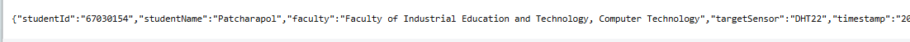
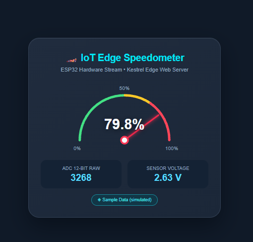
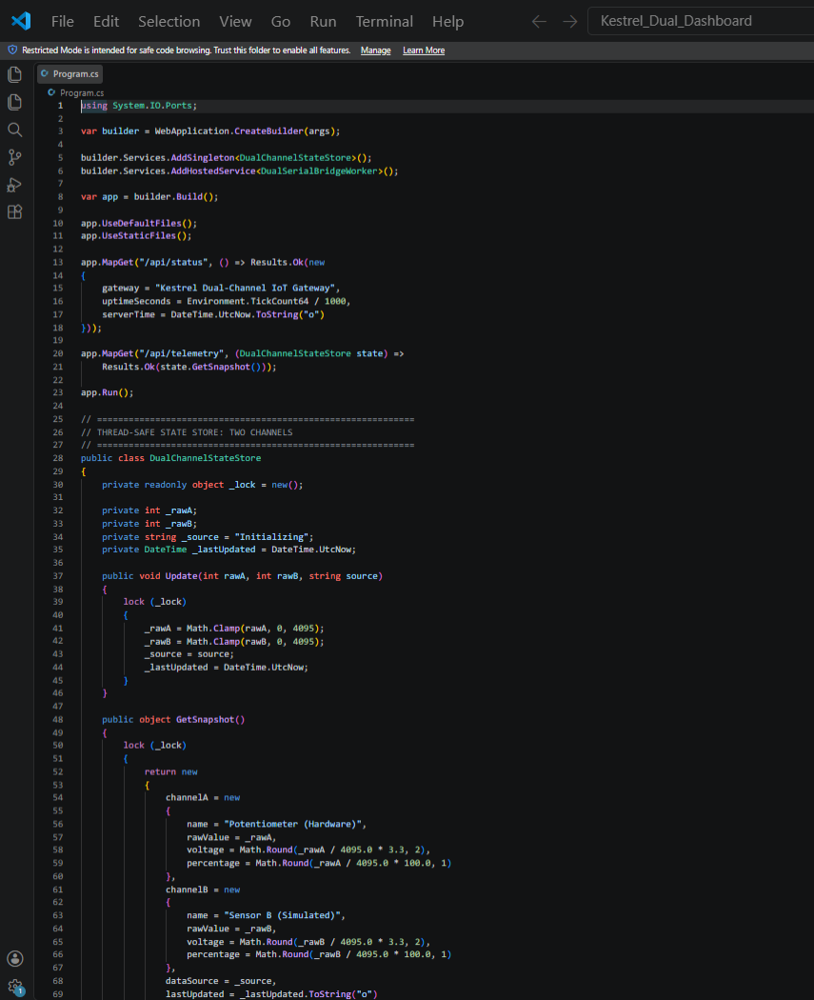
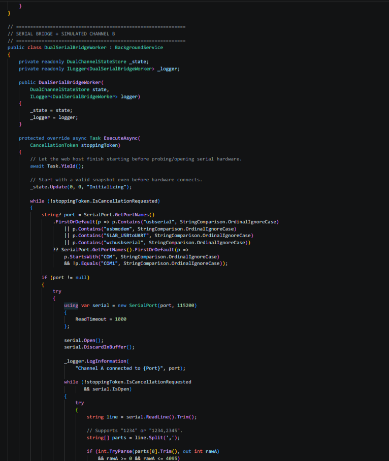
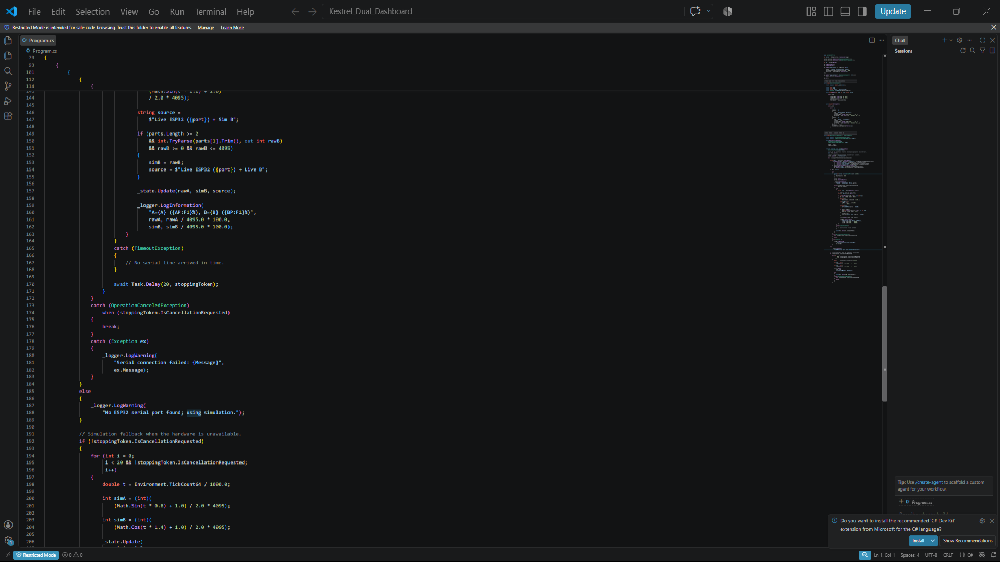
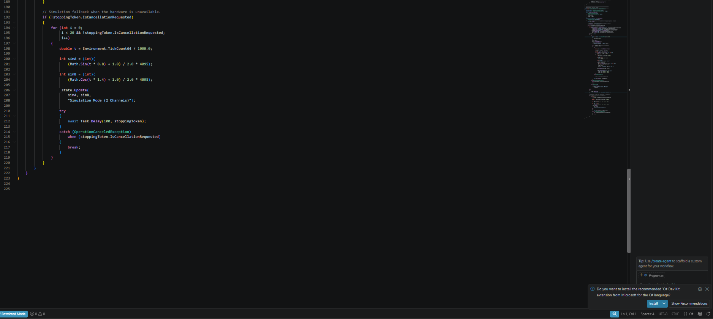

# Week 08 Report — Student 67030154

**ชื่อ:** Patcharapol  
**คณะ:** Faculty of Industrial Education and Technology, Computer Technology  
**Target sensor:** DHT22 / ESP32 potentiometer ตามกิจกรรม

## Lab 8.1 — Kestrel Minimal API

ผลที่สังเกตจากภาพ: endpoint คืนค่า JSON ที่มี studentId, studentName, faculty, targetSensor และ timestamp ครบถ้วน การส่ง anonymous object จาก Minimal API ถูก serialize เป็น JSON โดยอัตโนมัติ

**คำตอบ:** Minimal API ลดโค้ด boilerplate เพราะกำหนด route และ handler ได้โดยตรง ส่วน Kestrel ทำหน้าที่รับ TCP/HTTP request และส่ง response กลับโดยไม่ต้องพึ่ง IIS แยกต่างหาก

## Lab 8.2 — ESP32 ADC Serial Stream

| raw ADC | voltage | percentage |
|---:|---:|---:|
| 2784 | 2.24 V | 68.0% |
| 3382 | 2.73 V | 82.6% |
| 3882 | 3.13 V | 94.8% |

ค่าถูกส่งเป็นตัวเลขหนึ่งบรรทัดต่อหนึ่งตัวอย่างที่ 115200 bps ทำให้ฝั่ง C# อ่านด้วย ReadLine และแปลงเป็น integer ได้ง่าย

## Lab 8.3 — Hardware Serial Bridge

ภาพผลทดสอบแสดง 3 สถานะ: NORMAL, WARNING และ DANGER (HIGH) โดยใช้เปอร์เซ็นต์ ADC เป็นเกณฑ์ การแยก BackgroundService ออกจาก HTTP handler ช่วยไม่ให้การอ่าน Serial ขัดขวางการตอบ API

## Lab 8.4 — Interactive SVG Dashboard

ค่าจากภาพตัวอย่าง: **79.8%**, raw **3268**, voltage **2.63 V** การอัปเดตหน้าปัดทำผ่านการ polling endpoint แล้วแก้ DOM/SVG โดยไม่ reload หน้าเว็บ

## Lab 8.5 — Dual-Sensor Command Center

ระบบแบ่ง state เป็น channel A จาก ESP32 และ channel B จาก simulator ใช้ lock ป้องกันการอ่าน/เขียนข้อมูลพร้อมกันจาก BackgroundService และ HTTP request

**สรุป:** การออกแบบนี้ทำให้เว็บยังตอบสนองได้แม้ไม่มีบอร์ดจริง และเมื่อมี Serial Port ก็สลับมาใช้ข้อมูลฮาร์ดแวร์ได้
