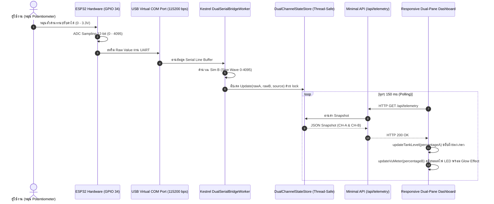

# รายงานผลการทดลอง ใบงานปฏิบัติการที่ 08-5
## ศูนย์ควบคุมเซนเซอร์คู่ IoT แบบเรียลไทม์ (Dual-Channel IoT Command Center)

---

### ข้อมูลผู้จัดทำ (Student Information)
* **ชื่อ-นามสกุล:** นางสาวภภัสสร เอี่ยมสอาด (Paphatsorn Aermsaarrd)
* **รหัสนักศึกษา:** `67030311`
* **สาขาวิชา:** ครุศาสตร์วิศวกรรมศาสตร์ สาขาวิชาเทคโนโลยีคอมพิวเตอร์
* **วิชา:** สถาปัตยกรรมและการพัฒนาเว็บแอปพลิเคชันสำหรับอุปกรณ์ IoT (Edge Web Server & IoT Dashboard)

---

## 1. การคำนวณกำหนดหน้าปัดเฉพาะบุคคล (Student-ID Gauge Assignment)

จากรหัสนักศึกษา `67030311` ดึงเลข 3 ตัวท้าย ($N$) ได้ดังนี้:
$$N = 311$$

### 1.1 สูตรคำนวณเกจ์ซ้าย (Channel A - Left Gauge)
$$\text{Left} = (N \pmod 4) + 1$$
$$311 \div 4 = 77 \quad (\text{เศษ } 3)$$
$$311 \pmod 4 = 3$$
$$\text{Left} = 3 + 1 = \mathbf{4}$$

$\rightarrow$ **หมายเลข 4: ถังของเหลวอุตสาหกรรม (Liquid Level Tank)**

---

### 1.2 สูตรคำนวณเกจ์ขวา (Channel B - Right Gauge)
$$\text{Right} = (\lfloor N / 4 \rfloor \pmod 4) + 1$$
$$\lfloor 311 / 4 \rfloor = 77$$
$$77 \div 4 = 19 \quad (\text{เศษ } 1)$$
$$77 \pmod 4 = 1$$
$$\text{Right} = 1 + 1 = \mathbf{2}$$

$\rightarrow$ **หมายเลข 2: แถบหลอดไฟ LED นีออน 10 ดวง (Audio VU Meter)**

---

### 1.3 ตรวจสอบกฎป้องกันเกจ์ซ้ำ (Anti-Collision Rule)
* $\text{Left} = 4$
* $\text{Right} = 2$
* $\text{Left} \ne \text{Right}$ (ไม่ซ้ำกัน จึงใช้ค่า $4$ และ $2$ ตามที่คำนวณได้โดยไม่ต้องปรับค่า)

**สรุปคู่เกจ์ที่ต้องพัฒนา:**
| ตำแหน่ง | แชนแนล | ชนิดเกจ์ที่ได้รับมอบหมาย | แหล่งที่มาของสัญญาณ |
| :--- | :---: | :--- | :--- |
| **เกจ์ซ้าย (Left)** | **CH-A** | **Liquid Level Tank (ถังระดับของเหลว)** | ฮาร์ดแวร์จริง Potentiometer บนบอร์ด ESP32 ผ่านสาย USB Serial Port |
| **เกจ์ขวา (Right)** | **CH-B** | **Audio VU Meter (10 LEDs)** | สัญญาณจำลองอัตโนมัติ (Mathematical Simulation / Sine Wave) บน C# Kestrel Worker |

---

## 2. สถาปัตยกรรมระบบ (System Architecture)



---

## 3. รูปแบบข้อมูล JSON API Contract (`/api/telemetry`)

ข้อมูล Telemetry แบบ 2 ช่องสัญญาณส่งคืนในรูปแบบ JSON ดังนี้:

```json
{
  "channelA": {
    "name": "Potentiometer (Hardware / Channel A)",
    "rawValue": 2840,
    "voltage": 2.29,
    "percentage": 69.4
  },
  "channelB": {
    "name": "Room Sensor / LDR (Simulated / Channel B)",
    "rawValue": 1720,
    "voltage": 1.39,
    "percentage": 42.0
  },
  "dataSource": "Live (COM3) + Sim B",
  "lastUpdated": "2026-09-18T00:15:00.0000000Z"
}
```

---

## 4. รายละเอียดการทำงานของโค้ดโปรแกรม

### 4.1 ฝั่งเซิร์ฟเวอร์ C# Kestrel (`Program.cs`)
1. **`DualChannelStateStore`:**
   - เป็น Singleton Class ใช้สำหรับเก็บสถานะล่าสุดของทั้ง 2 แชนแนล
   - มีการใช้คีย์เวิร์ด `lock (_lock)` ในการอ่านและเขียนข้อมูล เพื่อป้องกันปัญหา **Race Condition** เนื่องจากมีทั้ง Background Worker เธรดหนึ่งเขียนค่าเข้ามา และ HTTP Request เธรดอื่นอ่านข้อมูลออกไปพร้อมๆ กัน
   - ทำการแปลงสเกลค่า Raw ADC ($0 - 4095$) เป็นแรงดันไฟฟ้า ($0.00 - 3.30\text{ V}$) และเปอร์เซ็นต์ ($0.0 - 100.0\%$)
2. **`DualSerialBridgeWorker` (`BackgroundService`):**
   - ค้นหา COM Port ของอุปกรณ์ในระบบอัตโนมัติ โดยคัดกรองข้าม `COM1`
   - เชื่อมต่อ Serial ด้วย Baud rate `115200` พร้อมเปิด `DtrEnable = true` และ `RtsEnable = true`
   - รองรับทั้งกรณีที่ ESP32 ส่งค่าแชนแนลเดียว (สร้างสัญญาณ Sine Wave จำลองให้แชนแนล B) และกรณีส่ง 2 แชนแนลคั่นด้วยเครื่องหมายจุลภาค
   - มีระบบ **Fallback Simulation Mode** เมื่อไม่ได้เสียบสาย USB โดยสร้างสัญญาณคลื่น Sine และ Cosine ให้อัตโนมัติ ทำให้หน้าเว็บสามารถแสดงการทำงานได้ทันที

### 4.2 ฝั่งหน้าเว็บแดชบอร์ด (`wwwroot/index.html`)
1. **Responsive CSS Grid:**
   - จัดวางหน้าปัดด้วย `grid-template-columns: repeat(auto-fit, minmax(340px, 1fr))` ทำให้สามารถแสดงผลแบบคู่เคียงข้างกัน (Side-by-Side) บนหน้าจอเดสก์ท็อป และจัดเรียงลงมาเป็นแนวตั้งอัตโนมัติเมื่อดูผ่านสมาร์ตโฟน
2. **เกจ์ซ้าย: Liquid Level Tank (`updateTankLevel(percentage)`):**
   - ใช้องค์ประกอบ SVG ร่วมกับ `<clipPath id="tank-mask">` เพื่อบังคับของเหลวให้อยู่ในขอบมนของแท็งก์
   - คำนวณความสูง `fillHeight = (clampedPct / 100.0) * maxHeight`
   - คำนวณพิกัดแกน Y: `fillY = tankBottomY - fillHeight` (เนื่องจากแกน Y ของ SVG เพิ่มขึ้นจากบนลงล่าง)
   - ใส่สีของเหลวด้วย `<linearGradient>` ไล่เฉดสีฟ้า-น้ำเงิน และสร้างเส้นสะท้อนแสงผิวกระจกเพื่อความสมจริง
3. **เกจ์ขวา: Audio VU Meter (`updateVuMeter(percentage)`):**
   - มีหลอด LED ทั้งหมด 10 หลอด (เขียว 6 ดวง, เหลือง 2 ดวง, แดง 2 ดวง)
   - คำนวณจำนวนหลอดที่ต้องเปิด: `activeCount = Math.round((percentage / 100.0) * totalLeds)`
   - หลอดที่เปิดจะถูกปรับ `opacity = 1.0` และเพิ่มเอฟเฟกต์เรืองแสงนีออนด้วย CSS `filter = drop-shadow(0 0 6px ${color})`
   - หลอดที่ปิดจะปรับ `opacity = 0.15` และลบฟิลเตอร์แสงเรืองออก

---

## 5. วิธีการติดตั้งและรันโปรเจกต์ (How to Run)

### 5.1 รัน Kestrel Web Server
เปิด Terminal เข้าสู่โฟลเดอร์โปรเจกต์:
```powershell
cd lab8-5\Kestrel_Dual_Dashboard
dotnet run
```
จากนั้นเปิดเบราว์เซอร์ไปที่:
```text
http://localhost:5000
```

### 5.2 แฟลชโค้ด ESP32 (กรณีต่อฮาร์ดแวร์จริง)
1. ต่อวงจร Potentiometer ขากลางเข้ากับขา **GPIO 34** (ADC1_CH6) บน ESP32
2. บิลด์และแฟลชโค้ดจากโฟลเดอร์ `lab8-5\ESP32_ADC_Stream`:
```powershell
cd lab8-5\ESP32_ADC_Stream
idf.py set-target esp32
idf.py build flash monitor
```
3. เมื่อเปิดหน้าเว็บ เกจ์ซ้าย (Liquid Tank) จะตอบสนองต่อนิ้วหมุน Potentiometer แบบ Real-time ทันที
